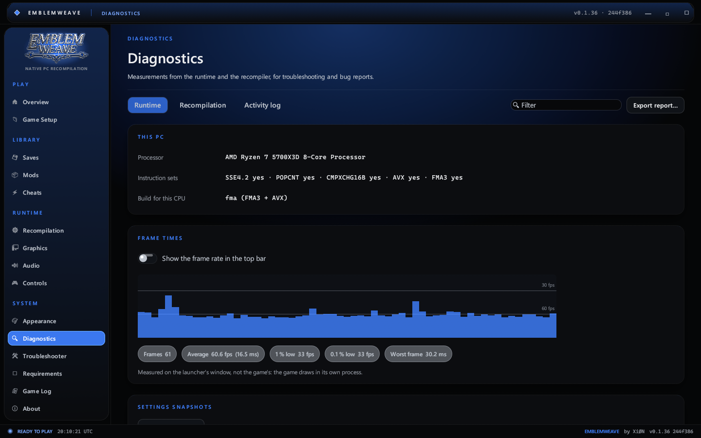
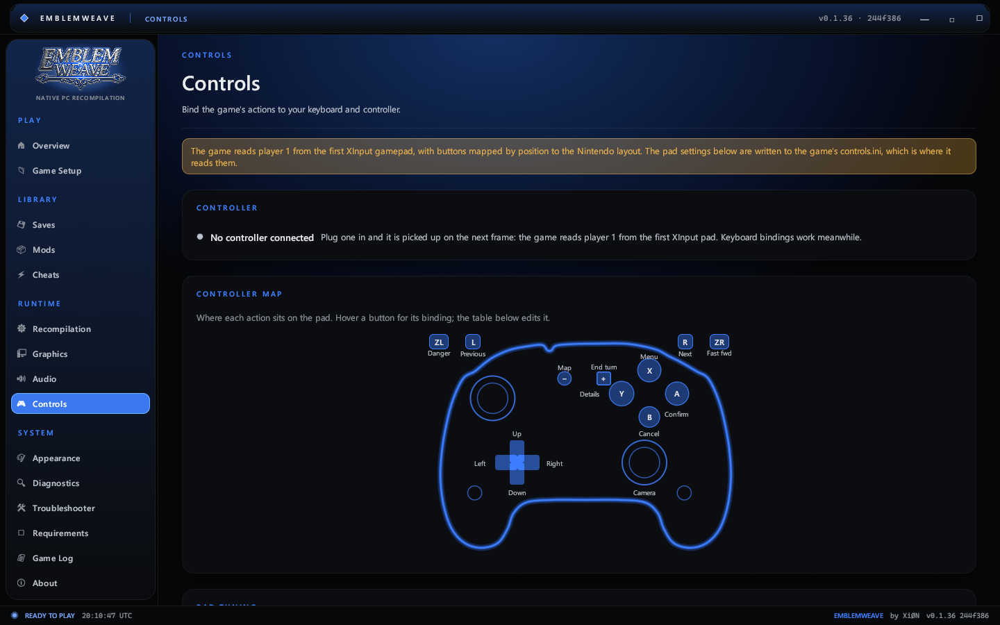

<p align="center">
  
</p>

<p align="center">
  <strong>A feature-rich recompilation launcher for <em>Fire Emblem: Fortune's Weave</em>, with integrated mod management and in-game enhancements.</strong><br>
  Recompiled ahead of time, and played natively with no emulator.<br>
  Built by <a href="https://github.com/XiONDiGiTaL">XiØN</a>.
</p>

<p align="center">
  <a href="https://xiondigital.net/EmblemWeave/">Site</a>
</p>

<p align="center">
  
  <a href="https://github.com/XiONDiGiTaL/EmblemWeave/releases"></a>
  
  
  
  
  
</p>

---

EmblemWeave is a feature-rich recompilation launcher for *Fire Emblem: Fortune's
Weave*. It builds the game ahead of time from your own dump and plays it natively
on Windows with no emulator, and it gathers everything around that into one
application: integrated mod management, save profiles and a save editor, cheats,
an in-game menu, and a recompilation pipeline you can watch run.

You supply the game from your own legally obtained copy. EmblemWeave contains no
game code, no assets and no keys, and it only ever reads your files.

The engine underneath is **fefw-recomp** by
[Goldoire](https://github.com/Goldoire/fefw-recomp) and its contributors. Its
author stepped away and the repository was removed;
[Obersteinn](https://github.com/Obersteinn) preserved the final 0.2.0 release with its build tools, so the
reference build and its tested-dump manifest are still available. EmblemWeave
carries that engine forward as the launcher around it, and
[docs/UPSTREAM.md](docs/UPSTREAM.md) records exactly what was kept.

> **Current status: 0.1.37, playable.** Build the game once from your dump, press **Play**. The 0.1.17 play test on an
> AMD Radeon RX 7900 XT ran at about 60 fps with sound, the opening movie and cutscenes; it covered the title screen, the
> save loaded through **Continue**, the hub, the in-game menu and the F1 settings overlay. Later releases are checked by
> building and by headless runs of the real game, listed under [Development status](#development-status). The build needs
> Visual Studio 2022 Build Tools with the C++ workload and no .NET SDK: the shader translator ships in the zip with its
> own runtime. What changed in each release is in the [changelog](docs/changelog/README.md).
>
> **The engine is fefw-recomp, integrated.** `engine/fefw-recomp` is the permanent primary engine and is built from source
> in this repository: its recompiler lifts the game's AArch64 code into C++, its CMake build compiles and links
> `fefw.exe`, and its runtime provides the system services, graphics and audio. EmblemWeave is the application around it:
> it validates the dump, configures the toolchain and the processor target, runs the build with progress and diagnostics,
> writes the engine's configuration, starts the game and explains failures. The Rust crates in `crates/` are supporting
> tools (format parsing, the reference interpreter used to verify the recompiler, and experimental runtime work). They are
> not a replacement engine and do not run the shipping game.

> **AI-assisted development.** EmblemWeave is designed and directed by [XiØN](https://github.com/XiONDiGiTaL) and developed
> with the help of AI coding tools. Every change is tested against the real game and the project's own test suite before it
> is published.

<p align="center">
  
</p>

## Contents

- [What EmblemWeave does](#what-emblemweave-does)
- [Features](#features)
- [Changelog](docs/changelog/README.md)
- [Screenshots](#screenshots)
- [Install and play](#install-and-play)
- [Using EmblemWeave](#using-emblemweave)
- [How the recompilation works](#how-the-recompilation-works)
- [Build from source](#build-from-source)
- [Security](docs/SECURITY.md)
- [Installation and game data](docs/INSTALL.md)
- [Launcher guide](docs/USAGE.md)
- [Building and testing](docs/BUILDING.md)
- [Troubleshooting](docs/TROUBLESHOOTING.md)
- [Legal](#legal)
- [Terms](docs/TERMS.md) and [privacy](docs/PRIVACY.md)
- [Credits](#credits)

## What EmblemWeave does

EmblemWeave is a launcher first, and the engine underneath it is fefw-recomp: the recompiler, build system and runtime
in `engine/fefw-recomp` (GPL-3.0, with its own licence and notices in that folder). It plays *Fire Emblem: Fortune's
Weave* on Windows with no emulator. The engine translates the game's code to C++, compiles it into `fefw.exe`, draws
with Vulkan, plays audio through XAudio2 and decodes the game's movies. EmblemWeave is the application around it: it
finds and checks your dump, drives the build, keeps your saves (including imports from Switch emulators), manages your
mods, starts the game and shows what happened when something fails.

| Stage | What happens |
| --- | --- |
| **Validate** | Your dump is located and checked against the title's module hashes and build ID. |
| **Prepare** | The console's compressed `main` is unpacked, and the RomFS is served from a folder, a plaintext `.nsp` or `.xci`, an `.nx`, or a `.nup`. |
| **Recompile** | fefw-recomp's lifter decodes every AArch64 instruction, recovers functions and control flow, and emits C++ for each of the six modules. |
| **Compile and link** | clang-cl compiles the emitted code and the runtime, and links `fefw.exe` for the processor and hook-site list this PC needs. |
| **Run** | The runtime maps the modules, starts them the way the console SDK does, serves their system calls natively, and drives NVN on the host GPU. |

The launcher wraps all of this in one application: it shows exactly what is
ready, what is running and where the runtime stops, and it never presents a
feature as working before it is.

## Features

| | |
| --- | --- |
| **Play natively** | Build the game once from your own dump, then play it at 60 fps with sound and its cutscenes, windowed or full screen. |
| **In-game enhancements** | F10 or Back + RB while playing: pause, screenshot, restart, stop and return, cheats and display settings. |
| **Saves** | Save profiles to switch between, imports from yuzu, suyu, sudachi, citron, Eden, Lichii, Fritchii and torzu, and a save editor (gold, renown, level, experience, stats, weapon masteries, items and spells). |
| **Mods** | Install RomFS mods from GameBanana (browse the game's list or paste a link), a .zip, .7z or .rar archive, or a folder, and switch each on or off. |
| **Cheats** | Quick per-unit cheats (infinite HP, quick level-up, max stats), Atmosphere cheat codes, and Cheat Engine tables with live, editable, freezable values. |
| **Launcher** | A custom shell with its own window controls, a rail of grouped pages, a status column that says where the game, the recompiler and the runtime stand, a live Game Log you can pop out, liquid-glass controls and sliders that take the colour and glow of the scheme, six schemes (XiØN, Arcade, FE, Ember, Verdant, Frost), diagnostics, and a recompilation pipeline you can watch run. |
| **Troubleshooter** | Re-runs the real game-data and toolchain checks, offers the safe repairs the launcher already knows (rebuild, reset graphics, open logs), and creates one timestamped `.zip` with settings, logs, the game log and any freeze report to attach to an issue. |

## Changelog

Each release is written up in [`docs/changelog/`](docs/changelog/README.md), newest first, with the version number and
what changed. The README keeps the current state; the changelog keeps the history.

## Development status

<details>
<summary><strong>Playable-build evidence, engine integration, known limitations and verification details</strong></summary>


Measured on the retail game (version 1.1.0, update 131072) on 16 November 2026.

### Playable build

The game builds from your own dump and plays. The launcher's **Build the game** runs fefw-recomp's lifter, compiles the
six modules and links `fefw.exe`; **Play** starts it with the chosen graphics, audio and controller settings.

- **0.1.17 play test**, AMD Radeon RX 7900 XT: about 60 fps with sound, the opening movie and cutscenes, the title
  screen, an existing save loaded through **Continue** into chapter 4, the hub walked with `W`, the in-game menu on
  `Tab`, the engine's settings overlay on `F1`, 47 to 68 fps and no errors in the log.
- **0.1.31 headless run**, `.nx` archive: the engine built a 252,693-file RomFS image and ran 25 s, exit 0.
- **0.1.32 headless run**, `.nup` package that packs 65,074 of its 252,686 files with zstd: full image, 25 s, 12,163
  presents, 85 textures, no crash, no unreadable file, with no unpacked copy on disk.
- **0.1.32 code-mod test**: a DLL built with clang-cl against `nxrt/mod_api.h` loaded from `mods/TestMod/exefs`, ran
  `nxmod_init`, saw 30 frames, and was told when one of its `.sites` entries was not in the build.

Requirements are listed under [System requirements](#system-requirements); failures and their messages under
[docs/TROUBLESHOOTING.md](docs/TROUBLESHOOTING.md).

### Engine integration

- `engine/fefw-recomp` is the integrated primary engine: lifter, generated code, runtime, services, graphics, audio and
  its own documentation. It is built from source in this repository, not launched as an external program.
- The launcher owns the build around it: toolchain probe, CMake cache and build folder handling, the Python decode step,
  the lift, the per-module compile and the link, plus the hook-site merge for code mods.
- The engine's configuration (`fefw.ini`, `controls.ini`, `NXRT_*` variables) is written by the launcher's pages and
  documented in `engine/fefw-recomp/runtime/docs/CONFIG.md`.
- Crash reports from the engine are read back by the launcher, which shows the decoded stop, the modules and the log.

### Compiler and toolchain

- The lifter, the generated C++ and the runtime are compiled with LLVM clang-cl and lld-link through CMake and Ninja. The
  launcher validates the exact executables and the Visual Studio environment before a build starts, records their
  fingerprint, and refuses to mix builds from different compilers.
- **Two processor targets.** The lifted code is built as `fma` (FMA3 + AVX) or `compat` (SSE4.2 + POPCNT, no FMA3).
  `apps/emblemweave/src/cpu.rs` probes the processor and passes `FEFW_CPU_VARIANT`; the engine re-checks at start and
  writes `fefw_fatal.txt` and exit code 4 naming anything missing. Both configure paths are verified: the `compat` tree
  contains no `-mfma`, and its stub compiles with `FEFW_CPU_NEEDS_COMPAT_BUILD`.
- Build folders are reused when the compiler, generator and toolchain file match, including a toolchain path spelled
  with `..`; a folder that lost its compiler is reset instead of failing.
- An optional `sccache` is used when present. The build takes a lock so two builds cannot write the same objects.

### Runtime

- The engine maps the six modules, runs the console SDK's start-up, and serves the game's system calls natively: kernel
  objects, threads and synchronization, `fsp-srv` with RomFS (folder, `.nsp`, `.nx`, `.nup`, plaintext `.xci`, zstd entries) and save data,
  `aoc:u`, `hid`, `time`, `pctl`, `lm`, `csrng`, applet and audio services.
- NVN is served on the host GPU through Vulkan. Movies decode with dav1d and libvpx on the host.
- Saves live in the launcher's profile directory and are imported from yuzu, suyu, sudachi, citron, eden and torzu.

### Graphics

- Vulkan 1.3 NVN shell, HDR output, swap-chain management, shader translation with a disk cache, GPU texture transcoding
  (BC, ASTC) and frame pacing.
- Upscaling: built-in TAAU, FSR 1, NVIDIA Image Scaling, FSR 3.1, DLSS / DLAA and XeSS, each with its own availability
  check; FSR 3 frame generation is implemented but cannot be used by this title, which provides no motion vectors.
- The evaluation of further options (FSR 4, OptiScaler, ReShade, vkBasalt) and their status are in
  [docs/GRAPHICS.md](docs/GRAPHICS.md).

### Audio

- The audio renderer runs on its 5 ms clock through XAudio2, and the game's voice buffers, sound effects and music reach
  it; the runtime log reports underruns, accepted and dropped buffers, and queue depth.

### Input

- Keyboard and up to four controllers through SDL 3 and XInput, with mappings in `controls.ini`, editable in the
  launcher's Controls page. The in-game menu opens on `F10` (or Back + RB) and can pause, screenshot, restart or stop.

### Launcher features

- Game data validation and preparation, builds with eight visible stages, save profiles and a save editor, Atmosphere
  cheats and Cheat Engine tables, quick cheats, an in-game menu, RomFS and code mods with profiles and conflict listing,
  GameBanana browsing, graphics and control settings, diagnostics with export, crash reports, six colour schemes and
  portable mode.

### Experimental components

The Rust crates in `crates/` are development tools, not the engine that runs the game:

| Area | Result |
| --- | --- |
| `ew-lift` decoder | 99.97% of 6,714,569 instruction words, including Advanced SIMD, system registers and supervisor calls |
| Control-flow recovery | 304,909 basic blocks in 3,620 complete functions (4,000-function pass); 151 switch tables resolved |
| Verification | 400 recovered functions and 2,400 vector-instruction runs identical to the reference interpreter, and the interpreter checked against Unicorn |
| `ew-boot` / `ew-gfx` | A run that reaches the first map load in the interpreter; a Vulkan device and presenter that serves NVN calls but does not yet draw the game's own geometry |

They are kept because they verify the recompiler's output and provide format tooling. They are not a replacement engine
and are not on the shipping path.

### Known limitations

- Encrypted retail `.xci` images are not decrypted: EmblemWeave reads plaintext/decrypted `.xci` files, and names the first encrypted NCA instead of unpacking garbage. A plaintext `.xci` is accepted like a plaintext `.nsp`; a folder, `.nsp`, `.nx` or `.nup` also works.
- FSR 4 is not integrated. The FidelityFX path calls FSR 3.1 upscaling through the SDK 2.4 Vulkan loader.
- Frame generation is not offered for this title: the engine's FSR 3 path needs motion vectors the game does not give it.
- Code mods are tested with the loader and site checks; a mod hooking a site that exists in the build, `make_function`,
  `make_writable` and `edit_file` have not been exercised end to end.
- The compatibility matrix is small: a Ryzen 7 5700X3D with an RTX 5060 (development PC) and the 0.1.17 test PC. Other
  CPUs and GPUs are supported in code but not each verified; [docs/PLATFORMS.md](docs/PLATFORMS.md) records what is
  known.


</details>

## Roadmap

<details>
<summary><strong>What is planned next, in priority order</strong></summary>


1. **P0 — real-hardware release validation.** Build the current tree and run the
   same matrix on 16 GB and 24 GB handhelds, discrete NVIDIA and AMD systems, and
   a clean Windows profile. The Low Memory and ExeFS patch changes are in 0.1.37;
   their hardware validation is still pending.
2. **P1 — game 1.1.1 compatibility.** Map the 1.1.1 build ID, add it to the
   tested manifest if upstream supports it, and refuse it early if not. Issue #41
   is a 1.1.1 run and compatibility is still unverified.
3. **P1 — controller trigger verification.** Record a physical ZL/ZR and
   vibration pass, and make the report name the pad and the observed trigger
   range.
4. **P2 — Low Memory and ExeFS patch validation.** Prove the profile on the
   hardware class it targets, and prove a real patch through the build.
5. **P3–P5 — saves, upscaler discovery, diagnostics, shader resources, Linux
   guidance and long-session telemetry.**

The detailed roadmap, with scope, users, requirements, risks, effort and success
criteria for each area, is in [docs/ROADMAP.md](docs/ROADMAP.md).


</details>

## Screenshots

| | |
| --- | --- |
|  |  |
| **Overview**: Play and Rebuild, save profiles and shortcuts, with the status column beside it | **Saves**: profiles, the slots in your save and the editor, imports from emulators |
|  |  |
| **Mods**: installed mods with on/off switches, archives, folders and GameBanana | **Cheats**: Atmosphere codes and Cheat Engine tables |
|  |  |
| **Game Setup**: your dump detected and validated | **Appearance**: the XiØN, Arcade, FE, Ember, Verdant and Frost schemes |
|  |  |
| **Recompilation**: the nine-stage pipeline | **Diagnostics**: what the runtime did and where it stopped |
|  |  |
| **Graphics**: display, upscalers and the Low Memory profile | **Audio**: output, mix and what the game will start with |
|  | |
| **Controls**: the pad map, bindings, trigger travel and tuning | |

The screenshots are the launcher's own rendering from the current source tree,
saved with `EmblemWeave.exe --page <page> --screenshot <file.png>`. The **Low
Memory** card on the Graphics screenshot is part of the 0.1.37 build, as is the
ExeFS patch support described on the Mods page. The screenshots were captured
from this tree.

## Key capabilities

<details>
<summary><strong>The deeper technical capabilities behind the feature list</strong></summary>


- **Static recompiler** for AArch64: integer, floating point, Advanced SIMD,
  atomics and exclusives, with an independent reference interpreter for every
  instruction.
- **Three layers of verification:** the emitted C against the interpreter, the
  vector unit against seeded edge cases (NaNs, infinities, signed zeros), and the
  interpreter against an independent CPU model.
- **Guest thread scheduler** with real blocking waits: mutexes, condition
  variables, events, timers, joins and sleeps, plus deadlock detection that names
  every waiting thread.
- **Native platform services:** the SDK's startup sequence, heap and frame-heap
  allocators, a read-only RomFS filesystem with a separate save directory, the
  musl C library (formatted I/O, parsing, a bit-exact math library), libc++ runtime
  pieces, and system settings such as language and profile.
- **Native execution:** the recompiled code compiled ahead of time into one
  library, entered at any block, checked call by call against the interpreter
  (`EW_NATIVE_CHECK=1`).
- **Its own presenter:** a Win32 window, a Vulkan surface and swap chain, and the
  game's swap texture untiled per frame and presented, independent of the
  baseline engine.
- **A complete launcher** with game-data detection, save profiles and editing,
  mod management and cheats, an in-game enhancements menu, a staged
  recompilation pipeline, diagnostics with search and export, and six colour
  schemes, all built from one set of liquid-glass controls that take their
  colour and glow from the scheme.


</details>

## System requirements

<details>
<summary><strong>Hardware, Windows and build-tool requirements</strong></summary>


| Component | Requirement |
| --- | --- |
| Operating system | Windows 10 or 11, 64-bit |
| Graphics | A GPU with a Vulkan 1.3 driver. Upscalers are optional and need their vendor files (see [Upscaling](#upscaling)) |
| Processor | x86-64 with SSE4.2, POPCNT and CMPXCHG16B: Intel Nehalem (2008) or AMD Bulldozer (2011) and newer. FMA3 + AVX (Intel Haswell 2013, AMD Piledriver 2012) get the faster build |
| Memory | 8 GB minimum, 16 GB recommended |
| Storage | About 30 GB for the extracted game data, plus space for build output |
| Game | Your own legally obtained copy of *Fire Emblem: Fortune's Weave* |

The engine builds the game's lifted code for one of two processor targets. The launcher probes the CPU and chooses:
`fma` (FMA3 + AVX, fused multiply-add for the guest's FMADD/FMLA family) where the processor has it, otherwise `compat`
(SSE4.2 + POPCNT, with `fma`/`fmaf` as correctly rounded library calls). Sandy Bridge, Ivy Bridge and Xeon E5 v1/v2 fall in
the second group. A processor without SSE4.2, POPCNT or CMPXCHG16B (Core 2, Phenom II and older) cannot run the game: the
launcher refuses to build for it, and an existing build moved to such a PC stops with exit code 4 and a message naming the
missing features in `fefw_fatal.txt` instead of an illegal-instruction crash. The Diagnostics page shows the brand, the
detected instruction sets and the target the next build will use.

Building the game needs the tools below. The launcher checks every one with the same detection the build uses before it
starts, and the Requirements page names each missing one with the command that installs it.

<!-- requirements:start -->
| Dependency | Needed for | Version | Missing it |
| --- | --- | --- | --- |
| Visual Studio C++ tools | Build the game | 2022 (17) or newer | `winget install --id Microsoft.VisualStudio.2022.BuildTools --exact --override "--add Microsoft.VisualStudio.Workload.VCTools --includeRecommended" --accept-package-agreements --accept-source-agreements` |
| Windows 10/11 SDK | Build the game | 10.0 | `Add Windows 11 SDK under Individual components in the Visual Studio Installer, or install the standalone SDK, then press Check again.` |
| LLVM (clang-cl and lld-link) | Build the game | 23 | `winget install --id LLVM.LLVM --exact --accept-package-agreements --accept-source-agreements` |
| CMake | Build the game | 3.25 | `winget install --id Kitware.CMake --exact --accept-package-agreements --accept-source-agreements` |
| Ninja | Build the game | any | `winget install --id Ninja-build.Ninja --exact --accept-package-agreements --accept-source-agreements` |
| NASM | Build the game (optional) | 2.14 | `winget install --id NASM.NASM --exact --accept-package-agreements --accept-source-agreements` |
| Git | Build the game (optional) | any | `winget install --id Git.Git --exact --accept-package-agreements --accept-source-agreements` |
| PowerShell 7 | Build the game (optional) | 7 | `winget install --id Microsoft.PowerShell --exact --accept-package-agreements --accept-source-agreements` |
| uv | Build the game (optional) | any | `winget install --id astral-sh.uv --exact --accept-package-agreements --accept-source-agreements` |
| .NET 10 SDK | Build the game (only without the bundled translator) | 10 | `winget install --id Microsoft.DotNet.SDK.10 --exact --accept-package-agreements --accept-source-agreements` |
| .NET runtime | Shaders (optional) | 10 | Only runs a translator that was built here without being published as one executable. The bundled one carries its own runtime. |
| Shader translator | Shaders | any | Turns the game's shaders into SPIR-V. The release zip carries it, published with its own .NET runtime. |
| Python | Decode | 3.9 | `winget install --id Python.Python.3.12 --exact --accept-package-agreements --accept-source-agreements` |
| zbic (Python package) | Decode | any | `py -m pip install zbic` |
| C compiler | Recompilation | any | `py -m pip install ziglang` |
<!-- requirements:end -->

The .NET 10 SDK is **not** needed: the release zip carries the shader translator published with its own runtime, so the
shader step runs on a PC with no .NET at all. The same sources also publish for Linux
(`EmblemWeave-vX.Y.Z-shader-translator-linux-x64.tar.gz`), and the build looks for the translator under
`tools/shaders/prebuilt/<platform>/`, so a Linux build picks the ELF binary on its own. For a Steam Deck, build on Windows
and run the result under Proton: [docs/STEAMDECK.md](docs/STEAMDECK.md) has the steps, the prefix paths and the `fefw.ini`
edits.

To build the launcher from source you also need the tools listed in [Building from source](#building-from-source).


</details>

## Security

EmblemWeave is one Rust executable plus the engine folder it drives. It installs no service, driver, or browser extension, has no accounts, and uploads nothing. It starts only the tools a build or a play needs, and every program and network destination is listed in [docs/SECURITY.md](docs/SECURITY.md).

The release zip is not code-signed; its SHA-256 is published in every release note. The source is public, so the strongest check is to build the same binary yourself. Report vulnerabilities privately through the repository's **Security** tab.

## Install and play

1. Download `EmblemWeave-<version>-windows-x64.zip` from the [releases page](https://github.com/XiONDiGiTaL/EmblemWeave/releases) and unzip it anywhere.
2. Run `EmblemWeave.exe`. A fresh release is **portable by default**: settings, saves, builds, mods and logs stay in `data` beside the executable, so the whole folder can be moved as one piece.
3. On **Game Setup**, choose your own dump: a `.nup`, `.nx`, plaintext `.nsp`, plaintext `.xci`, or an extracted folder.
4. Press **Build the game** once on **Overview**, then **Play**.

The build needs Visual Studio 2022 Build Tools with the C++ workload, LLVM, CMake and Ninja. The launcher checks each one and offers the install command. The shader translator ships in the zip with its own runtime, so the .NET SDK is not needed.

Full layouts, the ZBIC decode helper, portable switching and the exact release contents are in [docs/INSTALL.md](docs/INSTALL.md) and [docs/PACKAGE.md](docs/PACKAGE.md).

## Using EmblemWeave

The rail groups the pages: **Play** (Overview, Game Setup), **Library** (Saves, Mods, Cheats), **Runtime** (Recompilation, Graphics, Audio, Controls) and **System** (Appearance, Diagnostics, Troubleshooter, Requirements, Game Log, About). The top strip is the launcher's own shell, with the window controls, version and build revision; the strip along the bottom carries the current job and the readiness line.

**Overview** is the landing page: Play, Build, save profiles, the main-menu carousel, and the three status cards. **Troubleshooter** collects the checks a support reply would ask for, the safe repairs the launcher can run, and a button that builds an attachable report bundle. The other pages cover game setup, save profiles and the editor, mods, cheats, the recompilation pipeline, graphics and audio settings, controls, appearance, diagnostics, requirements and the live game log.

The full page-by-page guide, display settings, upscaling file layout and the in-game menu are in [docs/USAGE.md](docs/USAGE.md).

## How the recompilation works

The pipeline below is fefw-recomp's, and the launcher orchestrates it:

```
  your game data (folder, .nsp, .nx, .nup, .xci)
        │  validate the modules and the build ID
        ▼
  ExeFS ──► unpack main (ZBIC) ──► fefw-recomp lifter (recomp/)
        │                              decode AArch64, recover functions, emit C++
        ▼
  generated C++ per module ──► clang-cl + lld-link ──► fefw.exe (six modules, runtime, hook sites)
        │
        ▼
  fefw.exe: module mapping, console SDK start-up, kernel and service HLE,
            NVN on Vulkan, XAudio2 audio, RomFS and save data ──► the game runs
```

| Piece | Responsibility |
| --- | --- |
| `engine/fefw-recomp/recomp` | The lifter, its C++ emitter, the module build definitions and the hook-site format |
| `engine/fefw-recomp/runtime` | Execution: scheduler, kernel objects, services, RomFS and saves, NVN/Vulkan, audio, input, in-game menu and diagnostics |
| `engine/fefw-recomp/game-build` | Configure and build `fefw.exe`, the runtime checks and the tooling |
| `apps/emblemweave` | The launcher: dump validation, build orchestration, toolchain and CPU target, configuration, saves, mods, cheats and diagnostics |
| `crates/` | Supporting Rust tools: format parsing, the reference interpreter and experimental runtime work, used for verification and tooling |

Design notes are in [docs/ARCHITECTURE.md](docs/ARCHITECTURE.md); the engine's own documentation is in
`engine/fefw-recomp/README.md` and `engine/fefw-recomp/runtime/docs/`.

## Build from source

| Tool | Version | Used for |
| --- | --- | --- |
| [Rust](https://rustup.rs) | stable, 1.85 or newer | everything |
| Python | 3.10 or newer | the ZBIC decode helper and verification tools |
| `ziglang` (Python package) | any recent | compiling the emitted C during verification |

```powershell
git clone https://github.com/XiONDiGiTaL/EmblemWeave.git
cd EmblemWeave
cargo build --release -p emblemweave
```

The launcher is `target\release\EmblemWeave.exe`. The command-line tools (`ew-inspect`, `ew-lift`, `ew-run`, `ew-present`, `ew-native`), the engine's own CMake build, the verification scripts and the repository layout are documented in [docs/BUILDING.md](docs/BUILDING.md).

## Legal

EmblemWeave is an independent project by [XiØN](https://github.com/XiONDiGiTaL). It is not affiliated with,
endorsed by, or supported by Nintendo or Intelligent Systems. "Fire Emblem" and
"Fortune's Weave" are trademarks of their respective owners and are used only to
identify the software EmblemWeave works with.

The repository and its releases contain no game code, no game assets, no
firmware and no encryption keys, and EmblemWeave downloads none of them. Files
derived from your copy of the game (decoded modules and generated C) stay on
your machine and must not be redistributed. See [docs/LEGAL.md](docs/LEGAL.md).

## Terms and privacy

The project is free and open source, ships no game data or keys, does not condone piracy, and is not affiliated with Nintendo or Intelligent Systems. The full disclaimer, acceptable-use rules and contribution policy are in [docs/TERMS.md](docs/TERMS.md); what stays on your PC and what the optional report bundle contains is in [docs/PRIVACY.md](docs/PRIVACY.md).

## Credits

- **[XiØN](https://github.com/XiONDiGiTaL)**: Creator, Project Lead, Architecture & Design
- [Goldoire](https://github.com/Goldoire/fefw-recomp): fefw-recomp, the baseline engine, and everyone who contributed to that project. Its repository is no longer online; EmblemWeave continues from the snapshot in `engine/`
- [Obersteinn](https://github.com/Obersteinn): preserved the final fefw-recomp 0.2.0 release and its files after the original repository was removed, keeping the reference build, its build tools and its tested-dump manifest available ([docs/UPSTREAM.md](docs/UPSTREAM.md))
- [ranbinrang-rgb](https://github.com/ranbinrang-rgb): code mods, the DLL interface (`nxrt/mod_api.h`), the mod hook-site format and the loader (issue #31, PR #32)
- [moistman7](https://github.com/moistman7): the GT tone-curve HDR patch for Fortune's Weave's `ImageProcessing` shader (PR #40)
- [Ryujinx](https://git.ryujinx.app/ryubing/ryujinx) (MIT): shader translation, whose shader code the build uses
- [dav1d](https://code.videolan.org/videolan/dav1d) (BSD-2-Clause) and [libvpx](https://chromium.googlesource.com/webm/libvpx) (BSD-3-Clause): the host video decoders the baseline build links
- [roxmltree](https://github.com/RazrFalcon/roxmltree) (MIT / Apache-2.0) reads Cheat Engine tables; [windows-sys](https://github.com/microsoft/windows-rs) (MIT / Apache-2.0) reaches the game's memory and the controller
- [GameBanana](https://gamebanana.com/mods/games/26274) hosts the mods the Mods page lists; each mod belongs to its author
- [egui](https://github.com/emilk/egui): the launcher interface
- [libm](https://github.com/rust-lang/libm): musl's math library in Rust
- [lz4_flex](https://github.com/PSeitz/lz4_flex) and [ruzstd](https://github.com/KillingSpark/zstd-rs): decompression
- [Unicorn](https://www.unicorn-engine.org): the independent CPU model used in development
- [zbic](https://github.com/kinnay/zbic): the ZBIC decoder used by the decode helper

Follow development on [GitHub](https://github.com/XiONDiGiTaL/EmblemWeave).
Copyright © 2026 [XiØN](https://github.com/XiONDiGiTaL). EmblemWeave is free software under the GNU General Public License,
version 3 ([LICENSE](LICENSE)). Third-party code
keeps its own licence; [docs/THIRD_PARTY.md](docs/THIRD_PARTY.md) lists it.
