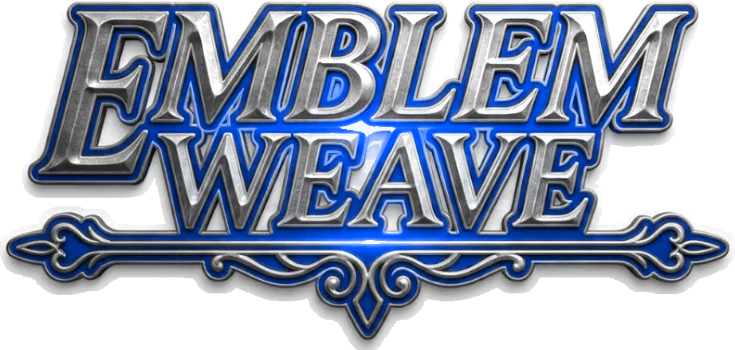
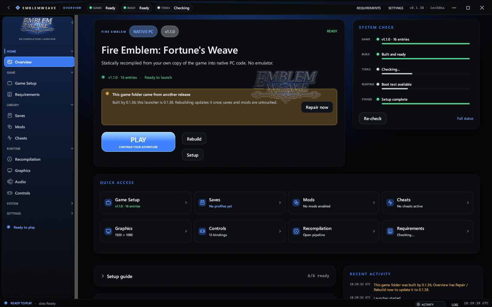

  

  <strong>A feature-rich recompilation launcher for <em>Fire Emblem: Fortune's Weave</em>, with integrated mod management and in-game enhancements.</strong> 
  Recompiled ahead of time, and played natively with no emulator. 
  Built by <a href="https://github.com/XiONDiGiTaL">XiØN</a>.

  <a href="https://xiondigital.net/EmblemWeave/">Site</a>

  
  
  
  
  
  
  

---

EmblemWeave is a feature-rich recompilation launcher for *Fire Emblem: Fortune's
Weave*. It builds the game ahead of time from your own dump and plays it natively
on Windows with no emulator, and it gathers everything around that into one
application: integrated mod management, save profiles and a save editor,
an in-game menu, and a recompilation pipeline you can watch run.

You supply the game from your own legally obtained copy. EmblemWeave contains no
game code, no assets and no keys, and it only ever reads your files.

The engine underneath is **fefw-recomp** by
[Goldoire](https://github.com/Goldoire/fefw-recomp) and its contributors. Its
author stepped away and the repository was removed;
[Obersteinn](https://github.com/Obersteinn) preserved the final 0.2.0 release with its build tools, so the
reference build and its tested-dump manifest are still available. EmblemWeave
carries that engine forward as the launcher around it, and
[docs/UPSTREAM.md](docs/UPSTREAM.md) records exactly what was kept.

> **Current status: 0.1.38, playable.** Build the game once from your dump, press **Play**. The 0.1.17 play test on an AMD Radeon RX 7900 XT ran at about 60 fps with sound, the opening movie and cutscenes. The 0.1.38 download includes the FSR 3.1 upscaler code path; the AMD FidelityFX DLLs are still yours to obtain (see Graphics page). Later releases are checked by building and by headless runs of the real game — see [Development status](docs/DEVELOPMENT.md) and the [changelog](docs/changelog/README.md).

Designed and directed by [XiØN](https://github.com/XiONDiGiTaL) and developed with the help of AI coding tools. Every change is tested against the real game and the project's own test suite before it is published.

  

## Documentation

The front page is the short version. Everything else lives in `docs/`:

- **Play:** [Install and play](#install-and-play) · [Using EmblemWeave](#using-emblemweave) · [Troubleshooting](docs/TROUBLESHOOTING.md)
- **Build and run:** [System requirements](docs/REQUIREMENTS.md) · [Install and play](#install-and-play) · [Building from source](docs/BUILDING.md) · [How the recompilation works](docs/ARCHITECTURE.md#how-the-recompilation-works)
- **Status:** [Development status](docs/DEVELOPMENT.md) · [Status](docs/STATUS.md) · [Roadmap](docs/ROADMAP.md) · [Changelog](docs/changelog/README.md) · [Screenshots](docs/SCREENSHOTS.md)
- **Reference:** [Features](#features) · [Key capabilities](docs/CAPABILITIES.md) · [Security](docs/SECURITY.md) · [Installation and game data](docs/INSTALL.md) · [Engine](docs/ENGINE.md) · [Graphics](docs/GRAPHICS.md)
- **Project:** [Legal](#legal) · [Terms](docs/TERMS.md) · [Privacy](docs/PRIVACY.md) · [Credits](#credits)

## What EmblemWeave does

EmblemWeave is a launcher first, and the engine underneath it is fefw-recomp: the recompiler, build system and runtime
in `engine/fefw-recomp` (GPL-3.0, with its own licence and notices in that folder). It plays *Fire Emblem: Fortune's
Weave* on Windows with no emulator. The engine translates the game's code to C++, compiles it into `fefw.exe`, draws
with Vulkan, plays audio through XAudio2 and decodes the game's movies. EmblemWeave is the application around it: it
finds and checks your dump, drives the build, keeps your saves (including imports from Switch emulators), manages your
mods, starts the game and shows what happened when something fails.

| Stage | What happens |
| --- | --- |
| **Validate** | Your dump is located and checked against the title's module hashes and build ID. |
| **Prepare** | The console's compressed `main` is unpacked, and the RomFS is served from a folder, a plaintext `.nsp` or `.xci`, an `.nx`, or a `.nup`. |
| **Recompile** | fefw-recomp's lifter decodes every AArch64 instruction, recovers functions and control flow, and emits C++ for each of the six modules. |
| **Compile and link** | clang-cl compiles the emitted code and the runtime, and links `fefw.exe` for the processor and hook-site list this PC needs. |
| **Run** | The runtime maps the modules, starts them the way the console SDK does, serves their system calls natively, and drives NVN on the host GPU. |

The launcher wraps all of this in one application: it shows exactly what is
ready, what is running and where the runtime stops, and it never presents a
feature as working before it is.

## Features

| | |
| --- | --- |
| **Play natively** | Build the game once from your own dump, then play it at 60 fps with sound and its cutscenes, windowed or full screen. |
| **In-game enhancements** | F10 or Back + RB while playing: pause, screenshot, restart, stop and return, display settings and cheats. |
| **Saves** | Save profiles to switch between, imports saves from Switch emulators, and a save editor (gold, renown, level, experience, stats, weapon masteries, items and spells). |
| **Mods** | Install RomFS mods from GameBanana (browse the game's list or paste a link), a .zip, .7z or .rar archive, or a folder, and switch each on or off. Mods are made by their authors and hosted by GameBanana; EmblemWeave does not review or host them. |
| **Cheats** | Quick per-unit cheats (infinite HP, quick level-up, max stats), Atmosphere cheat codes, and Cheat Engine tables with live, editable, freezable values. |
| **Launcher** | A custom shell with its own window controls, a rail of grouped pages, a status column that says where the game, the recompiler and the runtime stand, a live Game Log you can pop out, liquid-glass controls and sliders that take the colour and glow of the scheme, six schemes (XiØN, Arcade, FE, Ember, Verdant, Frost), diagnostics, and a recompilation pipeline you can watch run. |
| **Troubleshooter** | Re-runs the real game-data and toolchain checks, offers the safe repairs the launcher already knows (rebuild, reset graphics, open logs), and creates one timestamped `.zip` with settings, logs, the game log and any freeze report to attach to an issue. |

## Changelog

Each release is written up in [`docs/changelog/`](docs/changelog/README.md), newest first, with the version number and
what changed. The README keeps the current state; the changelog keeps the history.

## Status and roadmap

The game is playable: see [Development status](docs/DEVELOPMENT.md) for the measured evidence, [STATUS.md](docs/STATUS.md) for the compatibility matrix and known limitations, and [ROADMAP.md](docs/ROADMAP.md) for what is planned next, in priority order.

## Security

EmblemWeave is one Rust executable plus the engine folder it drives. It installs no service, driver, or browser extension, has no accounts, and uploads nothing. It starts only the tools a build or a play needs, and every program and network destination is listed in [docs/SECURITY.md](docs/SECURITY.md).

The release zip is not code-signed; its SHA-256 is published in every release note. The source is public, so the strongest check is to build the same binary yourself. Report vulnerabilities privately through the repository's **Security** tab.

## Install and play

1. Download `EmblemWeave-<version>-windows-x64.zip` from the [releases page](https://github.com/XiONDiGiTaL/EmblemWeave/releases) and unzip it anywhere.
2. Run `EmblemWeave.exe`. A fresh release is **portable by default**: settings, saves, builds, mods and logs stay in `data` beside the executable, so the whole folder can be moved as one piece.
3. On **Game Setup**, choose your own dump: a `.nup`, `.nx`, plaintext `.nsp`, plaintext `.xci`, or an extracted folder.
4. Press **Build the game** once on **Overview**, then **Play**.

The build needs Visual Studio 2022 Build Tools with the C++ workload, LLVM, CMake and Ninja. The launcher checks each one and offers the install command. The shader translator ships in the zip with its own runtime, so the .NET SDK is not needed.

Full layouts, the ZBIC decode helper, portable switching and the exact release contents are in [docs/INSTALL.md](docs/INSTALL.md) and [docs/PACKAGE.md](docs/PACKAGE.md).

## Using EmblemWeave

The rail groups the pages: **Play** (Overview, Game Setup), **Library** (Saves, Mods, Cheats), **Runtime** (Recompilation, Graphics, Audio, Controls) and **System** (Appearance, Diagnostics, Troubleshooter, Requirements, Game Log, About). The top strip is the launcher's own shell, with the window controls, version and build revision; the strip along the bottom carries the current job and the readiness line.

**Overview** is the landing page: Play, Build, save profiles, the main-menu carousel, and the three status cards. **Troubleshooter** collects the checks a support reply would ask for, the safe repairs the launcher can run, and a button that builds an attachable report bundle. The other pages cover game setup, save profiles and the editor, mods, cheats, the recompilation pipeline, graphics and audio settings, controls, appearance, diagnostics, requirements and the live game log.

The full page-by-page guide, display settings, upscaling file layout and the in-game menu are in [docs/USAGE.md](docs/USAGE.md).

## How the recompilation works

The pipeline is fefw-recomp's, and the launcher orchestrates it — the diagram, the stages and what each piece owns are in [ARCHITECTURE.md](docs/ARCHITECTURE.md#how-the-recompilation-works).

## Build from source

To build the launcher and the tools from source, see [BUILDING.md](docs/BUILDING.md).

## Legal

EmblemWeave is an independent project, not affiliated with,
endorsed by, or supported by Nintendo or Intelligent Systems. "Fire Emblem" and
"Fortune's Weave" are trademarks of their respective owners and are used only to
identify the software EmblemWeave works with.

The repository and its releases contain no game code, no game assets, no
firmware and no encryption keys, and EmblemWeave downloads none of them. Files
derived from your copy of the game (decoded modules and generated C) stay on
your machine and must not be redistributed. See [docs/LEGAL.md](docs/LEGAL.md).

## Terms and privacy

The project is free and open source, ships no game data or keys, does not condone piracy, and is not affiliated with Nintendo or Intelligent Systems. The full disclaimer, acceptable-use rules and contribution policy are in [docs/TERMS.md](docs/TERMS.md); what stays on your PC and what the optional report bundle contains is in [docs/PRIVACY.md](docs/PRIVACY.md).

## Credits

- **[XiØN](https://github.com/XiONDiGiTaL)**: Creator, Project Lead, Architecture & Design
- [Goldoire](https://github.com/Goldoire/fefw-recomp): fefw-recomp, the baseline engine, and everyone who contributed to that project. Its repository is no longer online; EmblemWeave continues from the snapshot in `engine/`
- [Obersteinn](https://github.com/Obersteinn): preserved the final fefw-recomp 0.2.0 release and its files after the original repository was removed, keeping the reference build, its build tools and its tested-dump manifest available ([docs/UPSTREAM.md](docs/UPSTREAM.md))
- [ranbinrang-rgb](https://github.com/ranbinrang-rgb): code mods, the DLL interface (`nxrt/mod_api.h`), the mod hook-site format and the loader (issue #31, PR #32)
- [moistman7](https://github.com/moistman7): the GT tone-curve HDR patch for Fortune's Weave's `ImageProcessing` shader (PR #40), the fefw-recomp 0.2.3/0.2.4 engine integration (PR #52), and the replay/HDR/sampler improvements (PRs #53–#55)
- [metrist38](https://github.com/metrist38/fefw-recomp): maintains the fefw-recomp fork that supplies updates beyond the original 0.2.0
- [dav1d](https://code.videolan.org/videolan/dav1d) (BSD-2-Clause) and [libvpx](https://chromium.googlesource.com/webm/libvpx) (BSD-3-Clause): the host video decoders the baseline build links
- [roxmltree](https://github.com/RazrFalcon/roxmltree) (MIT / Apache-2.0) reads Cheat Engine tables; [windows-sys](https://github.com/microsoft/windows-rs) (MIT / Apache-2.0) reaches the game's memory and the controller
- [GameBanana](https://gamebanana.com/mods/games/26274) hosts the mods the Mods page lists; each mod belongs to its author
- [egui](https://github.com/emilk/egui): the launcher interface
- [libm](https://github.com/rust-lang/libm): musl's math library in Rust
- [lz4_flex](https://github.com/PSeitz/lz4_flex) and [ruzstd](https://github.com/KillingSpark/zstd-rs): decompression
- [Unicorn](https://www.unicorn-engine.org): the independent CPU model used in development
- [zbic](https://github.com/kinnay/zbic): the ZBIC decoder used by the decode helper

Follow development on [GitHub](https://github.com/XiONDiGiTaL/EmblemWeave).
Copyright © 2026 [XiØN](https://github.com/XiONDiGiTaL). EmblemWeave is free software under the GNU General Public License,
version 3 ([LICENSE](LICENSE)). Third-party code
keeps its own licence; [docs/THIRD_PARTY.md](docs/THIRD_PARTY.md) lists it.
