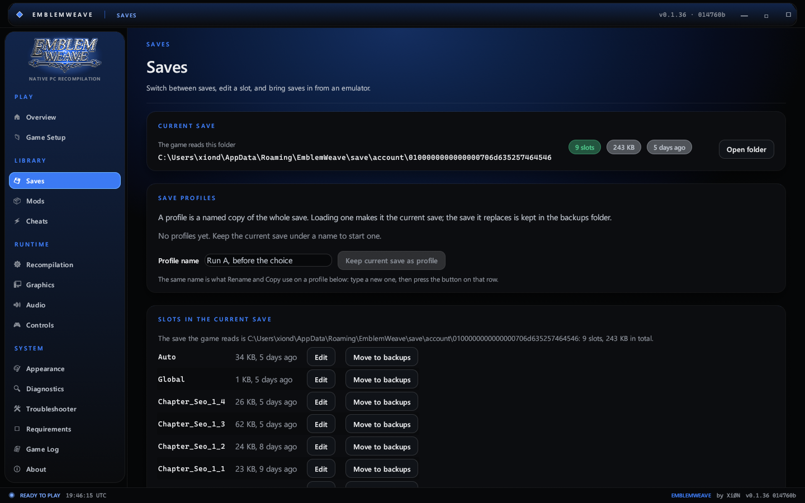
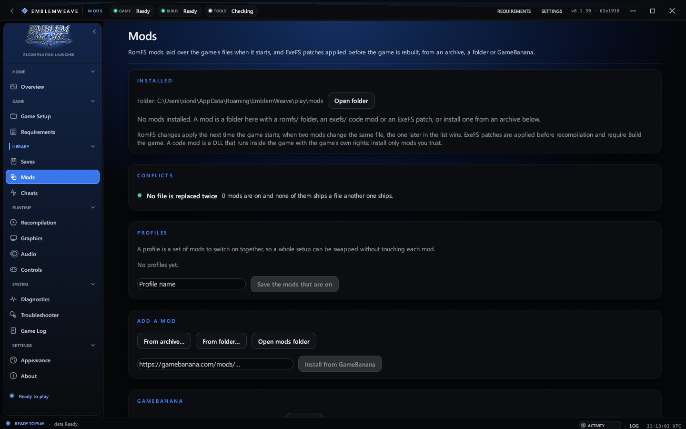
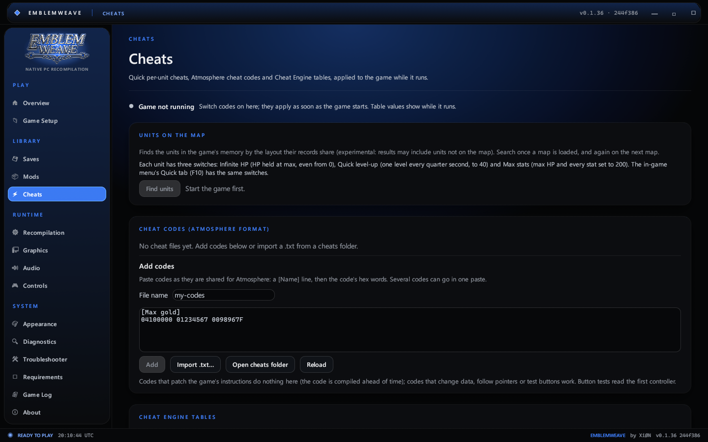
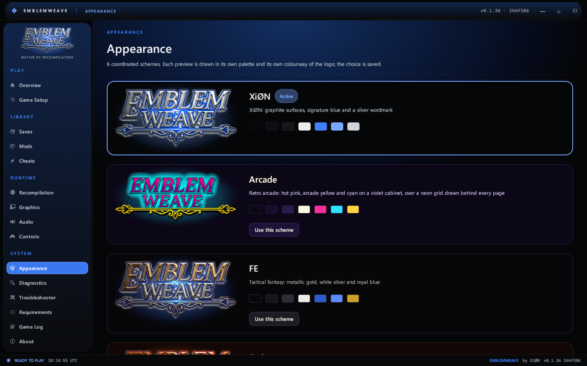
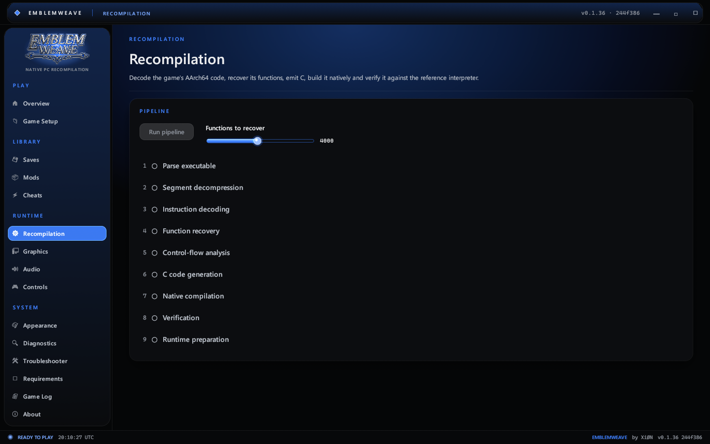

<p align="center">
  
</p>

<p align="center">
  <strong>A feature-rich recompilation launcher for <em>Fire Emblem: Fortune's Weave</em>, with integrated mod management and in-game enhancements.</strong><br>
  Recompiled ahead of time, and played natively with no emulator.<br>
  Built by <a href="https://github.com/XiONDiGiTaL">XiØN</a>.
</p>

<p align="center">
  <a href="https://xiondigital.net/EmblemWeave/">Site</a> ·
  <a href="docs/MIRRORS.md">Mirrors</a>
</p>

<p align="center">
  
  <a href="https://github.com/XiONDiGiTaL/EmblemWeave/releases"></a>
  
  
  
  
  
</p>

---

EmblemWeave is a feature-rich recompilation launcher for *Fire Emblem: Fortune's
Weave*. It builds the game ahead of time from your own dump and plays it natively
on Windows with no emulator, and it gathers everything around that into one
application: integrated mod management, save profiles and a save editor, cheats,
an in-game menu, and a recompilation pipeline you can watch run.

You supply the game from your own legally obtained copy. EmblemWeave contains no
game code, no assets and no keys, and it only ever reads your files.

The engine underneath is **fefw-recomp** by
[Goldoire](https://github.com/Goldoire/fefw-recomp) and its contributors. Its
author stepped away and the repository was removed;
[Obersteinn](https://github.com/Obersteinn) preserved the final 0.2.0 release with its build tools, so the
reference build and its tested-dump manifest are still available. EmblemWeave
carries that engine forward as the launcher around it, and
[docs/UPSTREAM.md](docs/UPSTREAM.md) records exactly what was kept.

> **Current status: 0.1.33, playable.** Build the game once from your dump, press **Play**. The 0.1.17 play test on an
> AMD Radeon RX 7900 XT ran at about 60 fps with sound, the opening movie and cutscenes; it covered the title screen, the
> save loaded through **Continue**, the hub, the in-game menu and the F1 settings overlay. Later releases are checked by
> building and by headless runs of the real game, listed under [Development status](#development-status). The build needs
> Visual Studio 2022 Build Tools with the C++ workload and no .NET SDK: the shader translator ships in the zip with its
> own runtime. What changed in each release is in the [changelog](docs/changelog/README.md).
>
> **The engine is fefw-recomp, integrated.** `engine/fefw-recomp` is the permanent primary engine and is built from source
> in this repository: its recompiler lifts the game's AArch64 code into C++, its CMake build compiles and links
> `fefw.exe`, and its runtime provides the system services, graphics and audio. EmblemWeave is the application around it:
> it validates the dump, configures the toolchain and the processor target, runs the build with progress and diagnostics,
> writes the engine's configuration, starts the game and explains failures. The Rust crates in `crates/` are supporting
> tools (format parsing, the reference interpreter used to verify the recompiler, and experimental runtime work). They are
> not a replacement engine and do not run the shipping game.

> **AI-assisted development.** EmblemWeave is designed and directed by [XiØN](https://github.com/XiONDiGiTaL) and developed
> with the help of AI coding tools. Every change is tested against the real game and the project's own test suite before it
> is published.

<p align="center">
  
</p>

## Contents

- [What EmblemWeave does](#what-emblemweave-does)
- [Features](#features)
- [Changelog](docs/changelog/README.md)
- [Development status](#development-status)
- [Screenshots](#screenshots)
- [Key capabilities](#key-capabilities)
- [System requirements](#system-requirements)
- [Security and what the launcher runs](#security-and-what-the-launcher-runs)
- [Installation](#installation)
- [What's in the release zip](docs/PACKAGE.md)
- [Running on a Steam Deck](docs/STEAMDECK.md)
- [Platforms, and the plan for Linux](docs/PLATFORMS.md)
- [Preparing your game data](#preparing-your-game-data)
- [Using the launcher](#using-the-launcher)
- [How the recompilation works](#how-the-recompilation-works)
- [Troubleshooting](docs/TROUBLESHOOTING.md)
- [Building from source](#building-from-source)
- [Testing and verification](#testing-and-verification)
- [Project structure](#project-structure)
- [Legal](#legal)
- [Credits](#credits)

## What EmblemWeave does

EmblemWeave is a launcher first, and the engine underneath it is fefw-recomp: the recompiler, build system and runtime
in `engine/fefw-recomp` (GPL-3.0, with its own licence and notices in that folder). It plays *Fire Emblem: Fortune's
Weave* on Windows with no emulator. The engine translates the game's code to C++, compiles it into `fefw.exe`, draws
with Vulkan, plays audio through XAudio2 and decodes the game's movies. EmblemWeave is the application around it: it
finds and checks your dump, drives the build, keeps your saves (including imports from Switch emulators), manages your
mods, starts the game and shows what happened when something fails.

| Stage | What happens |
| --- | --- |
| **Validate** | Your dump is located and checked against the title's module hashes and build ID. |
| **Prepare** | The console's compressed `main` is unpacked, and the RomFS is served from a folder, an `.nsp`, an `.nx` or a `.nup`. |
| **Recompile** | fefw-recomp's lifter decodes every AArch64 instruction, recovers functions and control flow, and emits C++ for each of the six modules. |
| **Compile and link** | clang-cl compiles the emitted code and the runtime, and links `fefw.exe` for the processor and hook-site list this PC needs. |
| **Run** | The runtime maps the modules, starts them the way the console SDK does, serves their system calls natively, and drives NVN on the host GPU. |

The launcher wraps all of this in one application: it shows exactly what is
ready, what is running and where the runtime stops, and it never presents a
feature as working before it is.

## Features

| | |
| --- | --- |
| **Play natively** | Build the game once from your own dump, then play it at 60 fps with sound and its cutscenes, windowed or full screen. |
| **In-game enhancements** | F10 or Back + RB while playing: pause, screenshot, restart, stop and return, cheats and display settings. |
| **Saves** | Save profiles to switch between, imports from yuzu, suyu, sudachi, citron, eden and torzu, and a save editor (gold, renown, level, experience, stats, weapon masteries, items and spells). |
| **Mods** | Install RomFS mods from GameBanana (browse the game's list or paste a link), a .zip, .7z or .rar archive, or a folder, and switch each on or off. |
| **Cheats** | Quick per-unit cheats (infinite HP, quick level-up, max stats), Atmosphere cheat codes, and Cheat Engine tables with live, editable, freezable values. |
| **Launcher** | A rail of grouped pages, a status column that says where the game, the recompiler and the runtime stand, a live Game Log you can pop out, liquid-glass controls and sliders that take the colour and glow of the scheme, six schemes (XiØN, Arcade, FE, Ember, Verdant, Frost), diagnostics, and a recompilation pipeline you can watch run. |

## Changelog

Each release is written up in [`docs/changelog/`](docs/changelog/README.md), newest first, with the version number and
what changed. The README keeps the current state; the changelog keeps the history.

## Development status

Measured on the retail game (version 1.1.0, update 131072) on 16 November 2026.

### Playable build

The game builds from your own dump and plays. The launcher's **Build the game** runs fefw-recomp's lifter, compiles the
six modules and links `fefw.exe`; **Play** starts it with the chosen graphics, audio and controller settings.

- **0.1.17 play test**, AMD Radeon RX 7900 XT: about 60 fps with sound, the opening movie and cutscenes, the title
  screen, an existing save loaded through **Continue** into chapter 4, the hub walked with `W`, the in-game menu on
  `Tab`, the engine's settings overlay on `F1`, 47 to 68 fps and no errors in the log.
- **0.1.31 headless run**, `.nx` archive: the engine built a 252,693-file RomFS image and ran 25 s, exit 0.
- **0.1.32 headless run**, `.nup` package that packs 65,074 of its 252,686 files with zstd: full image, 25 s, 12,163
  presents, 85 textures, no crash, no unreadable file, with no unpacked copy on disk.
- **0.1.32 code-mod test**: a DLL built with clang-cl against `nxrt/mod_api.h` loaded from `mods/TestMod/exefs`, ran
  `nxmod_init`, saw 30 frames, and was told when one of its `.sites` entries was not in the build.

Requirements are listed under [System requirements](#system-requirements); failures and their messages under
[docs/TROUBLESHOOTING.md](docs/TROUBLESHOOTING.md).

### Engine integration

- `engine/fefw-recomp` is the integrated primary engine: lifter, generated code, runtime, services, graphics, audio and
  its own documentation. It is built from source in this repository, not launched as an external program.
- The launcher owns the build around it: toolchain probe, CMake cache and build folder handling, the Python decode step,
  the lift, the per-module compile and the link, plus the hook-site merge for code mods.
- The engine's configuration (`fefw.ini`, `controls.ini`, `NXRT_*` variables) is written by the launcher's pages and
  documented in `engine/fefw-recomp/runtime/docs/CONFIG.md`.
- Crash reports from the engine are read back by the launcher, which shows the decoded stop, the modules and the log.

### Compiler and toolchain

- The lifter, the generated C++ and the runtime are compiled with LLVM clang-cl and lld-link through CMake and Ninja. The
  launcher validates the exact executables and the Visual Studio environment before a build starts, records their
  fingerprint, and refuses to mix builds from different compilers.
- **Two processor targets.** The lifted code is built as `fma` (FMA3 + AVX) or `compat` (SSE4.2 + POPCNT, no FMA3).
  `apps/emblemweave/src/cpu.rs` probes the processor and passes `FEFW_CPU_VARIANT`; the engine re-checks at start and
  writes `fefw_fatal.txt` and exit code 4 naming anything missing. Both configure paths are verified: the `compat` tree
  contains no `-mfma`, and its stub compiles with `FEFW_CPU_NEEDS_COMPAT_BUILD`.
- Build folders are reused when the compiler, generator and toolchain file match, including a toolchain path spelled
  with `..`; a folder that lost its compiler is reset instead of failing.
- An optional `sccache` is used when present. The build takes a lock so two builds cannot write the same objects.

### Runtime

- The engine maps the six modules, runs the console SDK's start-up, and serves the game's system calls natively: kernel
  objects, threads and synchronization, `fsp-srv` with RomFS (folder, `.nsp`, `.nx`, `.nup`, zstd entries) and save data,
  `aoc:u`, `hid`, `time`, `pctl`, `lm`, `csrng`, applet and audio services.
- NVN is served on the host GPU through Vulkan. Movies decode with dav1d and libvpx on the host.
- Saves live in the launcher's profile directory and are imported from yuzu, suyu, sudachi, citron, eden and torzu.

### Graphics

- Vulkan 1.3 NVN shell, HDR output, swap-chain management, shader translation with a disk cache, GPU texture transcoding
  (BC, ASTC) and frame pacing.
- Upscaling: built-in TAAU, FSR 1, NVIDIA Image Scaling, FSR 3.1, DLSS / DLAA and XeSS, each with its own availability
  check; FSR 3 frame generation is implemented but cannot be used by this title, which provides no motion vectors.
- The evaluation of further options (FSR 4, OptiScaler, ReShade, vkBasalt) and their status are in
  [docs/GRAPHICS.md](docs/GRAPHICS.md).

### Audio

- The audio renderer runs on its 5 ms clock through XAudio2, and the game's voice buffers, sound effects and music reach
  it; the runtime log reports underruns, accepted and dropped buffers, and queue depth.

### Input

- Keyboard and up to four controllers through SDL 3 and XInput, with mappings in `controls.ini`, editable in the
  launcher's Controls page. The in-game menu opens on `F10` (or Back + RB) and can pause, screenshot, restart or stop.

### Launcher features

- Game data validation and preparation, builds with eight visible stages, save profiles and a save editor, Atmosphere
  cheats and Cheat Engine tables, quick cheats, an in-game menu, RomFS and code mods with profiles and conflict listing,
  GameBanana browsing, graphics and control settings, diagnostics with export, crash reports, six colour schemes and
  portable mode.

### Experimental components

The Rust crates in `crates/` are development tools, not the engine that runs the game:

| Area | Result |
| --- | --- |
| `ew-lift` decoder | 99.97% of 6,714,569 instruction words, including Advanced SIMD, system registers and supervisor calls |
| Control-flow recovery | 304,909 basic blocks in 3,620 complete functions (4,000-function pass); 151 switch tables resolved |
| Verification | 400 recovered functions and 2,400 vector-instruction runs identical to the reference interpreter, and the interpreter checked against Unicorn |
| `ew-boot` / `ew-gfx` | A run that reaches the first map load in the interpreter; a Vulkan device and presenter that serves NVN calls but does not yet draw the game's own geometry |

They are kept because they verify the recompiler's output and provide format tooling. They are not a replacement engine
and are not on the shipping path.

### Known limitations

- `.xci` cartridge images are not read; use a folder, `.nsp`, `.nx` or `.nup`.
- FSR 4 is not integrated. The FidelityFX path calls FSR 3.1 upscaling through the SDK 2.4 Vulkan loader.
- Frame generation is not offered for this title: the engine's FSR 3 path needs motion vectors the game does not give it.
- Code mods are tested with the loader and site checks; a mod hooking a site that exists in the build, `make_function`,
  `make_writable` and `edit_file` have not been exercised end to end.
- The compatibility matrix is small: a Ryzen 7 5700X3D with an RTX 5060 (development PC) and the 0.1.17 test PC. Other
  CPUs and GPUs are supported in code but not each verified; [docs/PLATFORMS.md](docs/PLATFORMS.md) records what is
  known.

## Roadmap

1. Keep fefw-recomp integrated, updated and building from source, with its licence and notices intact.
2. Compiler and toolchain reliability: clearer failures, fewer environment assumptions, validated releases.
3. Processor compatibility: more build targets where they measurably help, and a compatibility report for every build.
4. Recompilation performance and generated-code quality, measured before and after each change.
5. Runtime stability and game compatibility, with diagnostics that separate engine faults from game faults.
6. Graphics: correctness first, then performance, then more upscalers after the inputs they need are verified.
7. Audio completeness and synchronization, particularly voice buffers and cutscenes.
8. Input compatibility: more controllers, better defaults, profiles.
9. Mod management and in-game enhancements.
10. Portable installation, configuration and a simpler first run.
11. Diagnostics, automated tests and long-term maintainability.

## Screenshots

| | |
| --- | --- |
|  |  |
| **Overview**: Play and Rebuild, save profiles and shortcuts, with the status column beside it | **Saves**: profiles, the slots in your save and the editor, imports from emulators |
|  |  |
| **Mods**: installed mods with on/off switches, archives, folders and GameBanana | **Cheats**: Atmosphere codes and Cheat Engine tables |
|  |  |
| **Game Setup**: your dump detected and validated | **Appearance**: the XiØN, Arcade, FE, Ember, Verdant and Frost schemes |
|  |  |
| **Recompilation**: the nine-stage pipeline | **Diagnostics**: what the runtime did and where it stopped |

The screenshots are the launcher's own rendering, saved with `EmblemWeave.exe --page <page> --screenshot <file.png>`.

## Key capabilities

- **Static recompiler** for AArch64: integer, floating point, Advanced SIMD,
  atomics and exclusives, with an independent reference interpreter for every
  instruction.
- **Three layers of verification:** the emitted C against the interpreter, the
  vector unit against seeded edge cases (NaNs, infinities, signed zeros), and the
  interpreter against an independent CPU model.
- **Guest thread scheduler** with real blocking waits: mutexes, condition
  variables, events, timers, joins and sleeps, plus deadlock detection that names
  every waiting thread.
- **Native platform services:** the SDK's startup sequence, heap and frame-heap
  allocators, a read-only RomFS filesystem with a separate save directory, the
  musl C library (formatted I/O, parsing, a bit-exact math library), libc++ runtime
  pieces, and system settings such as language and profile.
- **Native execution:** the recompiled code compiled ahead of time into one
  library, entered at any block, checked call by call against the interpreter
  (`EW_NATIVE_CHECK=1`).
- **Its own presenter:** a Win32 window, a Vulkan surface and swap chain, and the
  game's swap texture untiled per frame and presented, independent of the
  baseline engine.
- **A complete launcher** with game-data detection, save profiles and editing,
  mod management and cheats, an in-game enhancements menu, a staged
  recompilation pipeline, diagnostics with search and export, and six colour
  schemes, all built from one set of liquid-glass controls that take their
  colour and glow from the scheme.

## System requirements

| Component | Requirement |
| --- | --- |
| Operating system | Windows 10 or 11, 64-bit |
| Graphics | A GPU with a Vulkan 1.3 driver. Upscalers are optional and need their vendor files (see [Upscaling](#upscaling)) |
| Processor | x86-64 with SSE4.2, POPCNT and CMPXCHG16B: Intel Nehalem (2008) or AMD Bulldozer (2011) and newer. FMA3 + AVX (Intel Haswell 2013, AMD Piledriver 2012) get the faster build |
| Memory | 8 GB minimum, 16 GB recommended |
| Storage | About 30 GB for the extracted game data, plus space for build output |
| Game | Your own legally obtained copy of *Fire Emblem: Fortune's Weave* |

The engine builds the game's lifted code for one of two processor targets. The launcher probes the CPU and chooses:
`fma` (FMA3 + AVX, fused multiply-add for the guest's FMADD/FMLA family) where the processor has it, otherwise `compat`
(SSE4.2 + POPCNT, with `fma`/`fmaf` as correctly rounded library calls). Sandy Bridge, Ivy Bridge and Xeon E5 v1/v2 fall in
the second group. A processor without SSE4.2, POPCNT or CMPXCHG16B (Core 2, Phenom II and older) cannot run the game: the
launcher refuses to build for it, and an existing build moved to such a PC stops with exit code 4 and a message naming the
missing features in `fefw_fatal.txt` instead of an illegal-instruction crash. The Diagnostics page shows the brand, the
detected instruction sets and the target the next build will use.

Building the game needs the tools below. The launcher checks every one with the same detection the build uses before it
starts, and the Requirements page names each missing one with the command that installs it.

<!-- requirements:start -->
| Dependency | Needed for | Version | Missing it |
| --- | --- | --- | --- |
| Visual Studio C++ tools | Build the game | 2022 (17) or newer | `winget install --id Microsoft.VisualStudio.2022.BuildTools --exact --override "--add Microsoft.VisualStudio.Workload.VCTools --includeRecommended" --accept-package-agreements --accept-source-agreements` |
| Windows 10/11 SDK | Build the game | 10.0 | `Add Windows 11 SDK under Individual components in the Visual Studio Installer, or install the standalone SDK, then press Check again.` |
| LLVM (clang-cl and lld-link) | Build the game | 23 | `winget install --id LLVM.LLVM --exact --accept-package-agreements --accept-source-agreements` |
| CMake | Build the game | 3.25 | `winget install --id Kitware.CMake --exact --accept-package-agreements --accept-source-agreements` |
| Ninja | Build the game | any | `winget install --id Ninja-build.Ninja --exact --accept-package-agreements --accept-source-agreements` |
| NASM | Build the game (optional) | 2.14 | `winget install --id NASM.NASM --exact --accept-package-agreements --accept-source-agreements` |
| Git | Build the game (optional) | any | `winget install --id Git.Git --exact --accept-package-agreements --accept-source-agreements` |
| PowerShell 7 | Build the game (optional) | 7 | `winget install --id Microsoft.PowerShell --exact --accept-package-agreements --accept-source-agreements` |
| uv | Build the game (optional) | any | `winget install --id astral-sh.uv --exact --accept-package-agreements --accept-source-agreements` |
| .NET 10 SDK | Build the game (only without the bundled translator) | 10 | `winget install --id Microsoft.DotNet.SDK.10 --exact --accept-package-agreements --accept-source-agreements` |
| .NET runtime | Shaders (optional) | 10 | Only runs a translator that was built here without being published as one executable. The bundled one carries its own runtime. |
| Shader translator | Shaders | any | Turns the game's shaders into SPIR-V. The release zip carries it, published with its own .NET runtime. |
| Python | Decode | 3.9 | `winget install --id Python.Python.3.12 --exact --accept-package-agreements --accept-source-agreements` |
| zbic (Python package) | Decode | any | `py -m pip install zbic` |
| C compiler | Recompilation | any | `py -m pip install ziglang` |
<!-- requirements:end -->

The .NET 10 SDK is **not** needed: the release zip carries the shader translator published with its own runtime, so the
shader step runs on a PC with no .NET at all. The same sources also publish for Linux
(`EmblemWeave-vX.Y.Z-shader-translator-linux-x64.tar.gz`), and the build looks for the translator under
`tools/shaders/prebuilt/<platform>/`, so a Linux build picks the ELF binary on its own. For a Steam Deck, build on Windows
and run the result under Proton: [docs/STEAMDECK.md](docs/STEAMDECK.md) has the steps, the prefix paths and the `fefw.ini`
edits.

To build the launcher from source you also need the tools listed in [Building from source](#building-from-source).

## Security and what the launcher runs

EmblemWeave is one Rust executable plus the engine folder it drives. It installs no service, driver or browser
extension, ships no PHP, Python or AI runtime of its own, has no accounts, and uploads nothing. Saves, settings, mods,
logs and the decoded copy of your game all stay on your PC under `%APPDATA%\EmblemWeave`.

Everything the launcher starts, and why:

| Program | When | Why |
| --- | --- | --- |
| `vswhere.exe` | start-up, build | finds Visual Studio's C++ tools |
| `dotnet --list-sdks` | start-up, build | reads the installed SDK version |
| `spirv_harness.exe` | Build the game | the shader translator bundled in the zip; it carries its own .NET runtime and opens no network connection |
| `dotnet build` | Build the game, only when the zip has no translator | builds the translator from the staged sources |
| `git clone`, `git checkout` | Build the game | fetches the pinned Ryubing revision the shader translator is ported from |
| `pwsh` | Build the game | runs the engine's build scripts (`-NoProfile -ExecutionPolicy Bypass`) |
| `cmd /C recomp\scripts\build_game.cmd` | Build the game | drives the engine's own build |
| `cmake`, `ninja`, `clang-cl` | Build the game | configures and compiles the engine, one compiler per CPU core |
| `uv` | Build the game | makes the engine's Python environment and installs its pinned requirements |
| `python` | Decode | runs the zbic bridge compiled into the launcher; it reads your dump and writes the decoded copy |
| `clang` or `zig` | Recompilation | compiles the lifted C, and its verification program |
| `fefw.exe` | Play | the game itself |
| `curl.exe` | update check, mod browsing | see the network table below |
| `tar.exe` | unpacking a mod archive or an update | the archive you chose |
| `winget` | Install the missing build tools | only when you press that button |
| `notepad`, `explorer` | Open log, Open folder | opens the file or folder you asked for |

Every console program is created with `CREATE_NO_WINDOW`, so the launcher never opens a console window, and every
command it runs is written to the task's log in `%APPDATA%\EmblemWeave\logs`. The scripts it runs start their own
tools in turn (Visual Studio's `vcvars64.bat`, `robocopy`, `cmake`, `ninja`, `clang-cl`, `python`); those appear in the
same log, line by line, for every build. If you see terminal windows, shell
scripts or "press any key to continue" prompts while EmblemWeave is open, they are not from EmblemWeave.

Before a build starts, the launcher asks `vswhere` for Visual Studio, reads the MSVC toolset and the Windows SDK out of
the environment `vcvars64.bat` itself sets, checks `clang-cl` and `lld-link` beside each other, and then compiles and
links one small file with exactly that environment. A missing header, an install without the C++ workload or an `INCLUDE`
left by another shell stops the build in a second, with the piece named. `EmblemWeave.exe --check-toolchain` prints the
same report without a window (0 ready, 1 a piece is missing, 2 it cannot compile), and only one build can use the folder
at a time.

Network access, only for the action you asked for. The launcher's own HTTP goes through Windows' `curl.exe`; `git`
and `uv` make their own connections during a build:

| Destination | When | What is sent |
| --- | --- | --- |
| `api.github.com`, `github.com` and GitHub's release CDN | update check and update download | a plain `GET` for the release list or the zip; nothing about you or your game |
| `gamebanana.com` | browsing or installing a mod you chose | the page or file id you asked for |
| `git.ryujinx.app` | Build the game, shader step | a filtered clone of the Ryubing fork, checked out at the revision pinned in `engine.rs`; no credentials |
| `pypi.org` (through `uv`) | Build the game, Python step | installs the packages pinned in `recomp/requirements.txt` |

There is no telemetry, no analytics and no crash upload: the Diagnostics report is a text file you export and send
yourself.

**Build the game** downloads the engine's pinned third-party sources once, because the engine compiles them from
source: SDL3, Vulkan-Headers, volk, VulkanMemoryAllocator, Dear ImGui and zstd through CMake
(`runtime/cmake/gfx_deps.cmake`), and astc-encoder, bc7enc_rdo and ispc through the texture script
(`tools/textures/scripts/fetch_third_party.ps1`). The shader step additionally clones the pinned Ryubing revision named
above, and stages three of its projects for the translator. Every one of those URLs is written out in those files, and
each CMake download is checked against the `SHA256` pinned beside it.

The release zip is not code-signed; instead its `sha256` is published in every release note. The source is public,
so the strongest check is to build the same binary yourself (`cargo build --release -p emblemweave`) and compare.
Security reports are welcome through the repository's **Security** tab as a private advisory.

## Installation

Download `EmblemWeave-<version>-windows-x64.zip` from the [releases page](https://github.com/XiONDiGiTaL/EmblemWeave/releases),
unzip it anywhere and run `EmblemWeave.exe`. Choose your game on **Game Setup**, then press **Build the game** on the
Overview page (once; it lists any build tools you still need) and **Play**. To build the launcher yourself, see
[Building from source](#building-from-source).

Settings are saved to `%APPDATA%\EmblemWeave\config.json`. Decoded modules and
build output go to `%APPDATA%\EmblemWeave\work`, and save data to
`%APPDATA%\EmblemWeave\save`. Your game folder is never written to.

The zip and what it deliberately leaves out are listed in [docs/PACKAGE.md](docs/PACKAGE.md), and
`tools/package_release.ps1` builds it reproducibly.

### Portable mode

A fresh copy keeps everything in its own folder without being asked: on its first start, when there is no
`%APPDATA%\EmblemWeave` yet, the launcher puts its data in `data` beside `EmblemWeave.exe`, holding `play` (the run
folder and its `fefw.ini`), `work` (decoded modules and build output), `save` and `logs`. Unzip it anywhere, carry it on
a stick, and the whole thing moves as one piece with its saves and its build cache; nothing on the PC knows it is there.

A copy that has been using the profile folder can switch: **About → Storage → Keep everything in this folder** writes
the marker, creates `data` and copies your saves across, and the game is built into the new folder on the next build.
Delete `portable.txt` to go back to `%APPDATA%\EmblemWeave`. The game's own dump is read where it is, in either mode.

### Where the folder can live

Spaces are fine, including in a folder named after the game: a build was run from a path with spaces to check it. An
apostrophe and a non-ASCII character each used to be a trap for the shader translator, which MSBuild builds with item
transforms written as `@(Item->'…')`; when the path has either, the launcher builds the translator from a copy under its
own work folder and copies the result back, so the folder can be named anything without being renamed. Long paths, past
about 120 characters, still make CMake warn about object file paths; a shorter folder avoids the question.

## Preparing your game data

The simplest way is a **`.nup` dump** of your own copy of the game. On the
**Game Setup** page, choose **Choose package…** and select the file. EmblemWeave
then does the rest:

- it checks the container's table of contents and every file it reads against
  their SHA-256 hashes, so a damaged dump is reported rather than used;
- it copies the small ExeFS (about 70 MB) once into its work folder;
- it reads the RomFS (26 GB) **in place** from the `.nup`, so nothing has to be
  extracted, and it takes the title and version from the dump's own metadata.

The `.nup` is only ever read.

A **`.nx` archive** (NXFormat) works the same way. Its catalog, manifest and
block index are checked against the SHA-256 values in the archive's own header,
the ExeFS is copied out once, and the engine serves the RomFS straight from the
archive: each block is decompressed and its 16 KiB slices checked with CRC-32C
as the game reads them. Point **Choose package…** at the `.nx`; nothing is
extracted and the file is only ever read.

**Which build your copy is.** Game Setup also hashes your ExeFS modules against
the manifest the engine was tested with, taken from the preserved fefw-recomp
0.2.0 package: update 131072, `main` build `db93b0125f48…`. If all seven hashes
agree the check says so; a different build is reported as such, and still
recompiles, since the pipeline works from your own modules.

An **`.nsp` package** works too, when it is a plaintext repack: NSP Box writes
those without keys, as unsigned program, control and meta NCAs. Pick it with
**Choose package…** as well. EmblemWeave unpacks it itself, once, into
`%APPDATA%\EmblemWeave\work\nsp`, then uses that folder like an extracted dump,
so the game boots from it and the recompiler reads it. The unpack is repeated
only when the package's size or modification time changes, and the folder can be
deleted to reclaim the space.

You can also use an extracted copy. EmblemWeave then needs:

| Item | What it is | Where it usually is |
| --- | --- | --- |
| ExeFS | The game's executable modules (`main`, `sdk`, `main.npdm`, ...) | `exefs\` |
| RomFS | The game's assets (`Fs.bin.zst` and the asset folders) | `romfs\` |
| `control.nacp` | Title metadata, including the version | `data\control\control.nacp` in an NSP extraction |

Choose the containing folder with **Folder…** on Game Setup. Plain dumps and NSP
extractions are both detected automatically, and every location can be set
individually. A retail NSP stays encrypted with the console's own keys, which
EmblemWeave neither has nor asks for, so only plaintext repacks are unpacked.

The game's `main` module is compressed with ZBIC, a Zstandard variant. Decode it
once with **Decode main module** on Game Setup. This currently uses a small
helper script and the Python `zbic` package:

```powershell
python -m pip install zbic
```

## Using the launcher

The rail groups the pages: **Play** (Overview, Game Setup), **Library** (Saves, Mods, Cheats), **Runtime**
(Recompilation, Graphics, Audio, Controls) and **System** (Appearance, Diagnostics, Game Log, About). The strip along
the top carries the wordmark, the page you are on, and the version with the build revision; the strip along the bottom
carries the current job's progress or the readiness line, and the last thing the launcher did. On **Overview**, the
column on the right shows where the game data, the recompiler and the runtime stand, and what the launcher has just done.

The launcher opens at 1440×900 and works down to 1120×720. The page column stops at a fixed measure and is centred, so
a wide window does not stretch the text; below 1240 wide the status column steps aside so the page keeps its width; the
rail fits all thirteen pages at the smallest height; and the lists inside pages grow and shrink with the window. Every
button is the same size, and every control (buttons, sliders, switches, cards) is one liquid-glass material that
takes the chosen scheme's accent, glow and rim.

| Page | Purpose |
| --- | --- |
| **Overview** | **Play** starts the game; **Build the game** compiles it from your dump. Load a save profile and jump to the save editor, mods and cheats. Also readiness, the boot test of the Rust runtime, next steps, and recent activity. |
| **Game Setup** | Choose and validate your game data (a `.nup`, `.nx`, `.nsp` package or a folder) and set the language and profile. |
| **Saves** | Save profiles: keep the current save under a name and load any profile later (the save it replaces goes to the backups folder). Lists the slots in the current save, with an editor for gold, renown and each unit's level, experience, max HP, stat gains, weapon masteries, items and spells; names come from your own game data. Imports saves from yuzu, suyu, sudachi, citron, eden and torzu, from any folder, and exports to the emulator layout. |
| **Mods** | Installed RomFS mods, switched on and off with a toggle. Installs from a .zip, .7z or .rar archive, a folder, a GameBanana link, or the game's GameBanana list browsed in the launcher. Code mods made for the engine (a DLL in the mod's `exefs`, `engine/fefw-recomp/runtime/include/nxrt/mod_api.h`) are installed and load when the game starts; one that brings hook sites (`exefs/*.sites`) asks for Build the game once after it is installed, updated or removed. Mods that only patch the game's code with `.ips` / `.pchtxt` are recognised and not installed, since those patches cannot apply to a recompiled game. |
| **Cheats** | Atmosphere cheat codes, pasted or imported as `.txt`, each switched on and off and applied about 60 times a second while the game runs (data writes, pointer chains, conditionals, loops and controller-button tests work; instruction patches do not). Cheat Engine tables (`.CT`): `aobscan`/`aobscanregion` entries search the game's memory, and the values below them show live, can be typed in, and can be frozen. |
| **In-game menu** | While the game runs, F10 (or Back + RB on a controller) opens EmblemWeave's menu on top of it: pause and resume, a screenshot of the game window (saved to Pictures\EmblemWeave), restart at the title screen, stop and return to the launcher, quick cheats, cheat codes and tables, display settings (window mode, picture size, frame rate counter) and the controls in use. |
| **Quick cheats** | Per-unit switches for the units found in the game's memory, using the record layout of the community Cheat Engine tables (stats are single bytes, experience is a running total): infinite HP (current HP held at the unit's max HP every tick, including from 0 HP), quick level-up (the level rises one step every quarter second, up to 40) and max stats (max HP and every stat set to 200). The same switches are on the launcher's Cheats page and the in-game menu's Quick tab (F10); search again after a map loads. |
| **Recompilation** | Run the nine-stage pipeline (parse, decompress, decode, recover, analyse, emit C, compile, verify, prepare) with live progress. |
| **Graphics, Audio, Controls** | **Graphics** writes the settings the engine can act on into `fefw.ini` and `controls.ini` before every start: picture size and render scale, window mode, vsync, aspect ratio, frame-rate cap and the upscaler (Off, FSR 1.0, FSR 3.1, NVIDIA Image Scaling, DLSS or DLAA). Only values that changed since the last start are written, so a setting changed in the game's own F1 menu stands until you change it here. The upscaler row shows the folder its DLLs were found in, or what is missing. Quality and shader precompiling are saved and marked until EmblemWeave's own renderer arrives. **Audio**'s master volume goes to the same file; music, effects and voice wait for mixing. While playing, display settings are in the in-game menu and full rebinding is in the engine's F1 menu. |
| **Appearance** | Choose between the [XiØN](https://github.com/XiONDiGiTaL) scheme (XiØN's own palette, from xiondigital.net), Arcade (a retro video-game palette of hot pink, arcade yellow and cyan on violet, over a neon grid), FE (gold, white silver and royal blue), Ember (ember orange and molten gold over oxblood steel), Verdant (emerald and pale gold over moss-black) and Frost (glacier blue and ice silver over midnight). The logo artwork is recoloured to match each scheme, and every control takes its accent, its glow and its rim from it. |
| **Diagnostics** | Stop reason, guest threads, host events, imports reached and the final events before a stop, with search and export. Its **Log** tab lists the log files: every task writes its own under `%APPDATA%\EmblemWeave\logs`, with the compiler or script it ran, that tool's whole output, and why it stopped, so a failure can be sent on instead of described. |
| **Game Log** | The game engine's log, followed live while the game runs: info, warnings and errors (each counted and filterable), search, copy, this run or the previous one, and **Pop out** to keep it in a window of its own. |
| **About** | Version, build revision, what each runtime is, credits and legal information. |

Press <kbd>Ctrl</kbd> + <kbd>1</kbd> to <kbd>9</kbd> to jump between pages. From the command line,
`EmblemWeave.exe --page Diagnostics` opens a page, `--build-engine` builds the game as soon as your game data is detected,
`--boot-test` runs the boot test, `--screenshot <file.png>` saves the launcher's own frame and closes, and `--tour` walks through the features by itself (for recording showcase footage; it never saves settings).

The game runs from `%APPDATA%\EmblemWeave\play`, where the launcher writes its `fefw.ini`. RomFS mods go in that folder's `mods`
folder, one folder per mod holding `romfs/` (the layout emulators use). Every engine option is described in
`engine/fefw-recomp/runtime/docs/CONFIG.md`.

### Display settings

**Graphics** also carries the display options the game takes from its own files. **Resolution** sets the window and the
picture the game renders (1280×720 to 3840×2160, or *Native display* to keep the game's own console size), **Render
scale** the picture relative to it (0.50× to 2.00×, with the upscaler filling the rest), **Display mode** the window
mode, **Aspect ratio** the shape the game renders, **VSync** the presentation sync, and **Frame-rate limit** the
presentation cap. They are written to `controls.ini` (and the picture size to `[fefw] output` in `fefw.ini`) before
each start, so they apply the next time the game opens. **Audio**'s **Master** volume goes to `[audio] volume` in the
same file; **Music**, **Effects** and **Voice** are the game's own mix and have no key there yet.

Both pages read the files back. A **What the game will start with** panel lists what the engine will actually do on
the next start (upscaler, output, window and picture size, frame limit, vsync and aspect ratio on **Graphics**; master
volume on **Audio**) and names the settings still waiting for that start, so a value changed after the last run
is never mistaken for one already in force, and a setting the game's own F1 menu changed since is taken back onto
the page, so the two always agree unless you have changed the page yourself and not started the game yet.

### Upscaling

The engine upscales the picture itself, and **Graphics > Upscaling** chooses how: **FSR 1.0** (AMD's spatial upscaler,
any GPU), **NVIDIA Image Scaling** (spatial, any GPU, up to 2× per side), **FSR 3.1** (AMD's temporal upscaler through the
FidelityFX API), **DLSS** / **DLAA** (NVIDIA's temporal upscaler through Streamline) and **XeSS** (Intel's temporal
upscaler, on any GPU with DP4a). The launcher writes the choice, and the folder it found the DLLs in, into the run
folder's `fefw.ini` before it starts the game, so it applies at the game's next start.

**Graphics > Sharpening** sets how crisp the final picture is: **Off**, **Low**, **Default** (the engine's own 0.8) or
**High**. It is the engine's `[upscale] sharpness`, it applies live rather than at the next start, and the game's own
F1 menu sees the same value.

AMD's, NVIDIA's and Intel's files cannot be shipped, so those upscalers need you to add them, in the run folder:

- **FSR 3.1**: `amd_fidelityfx_loader_vk.dll` and `amd_fidelityfx_upscaler_vk.dll` from the FidelityFX SDK (v2.4.0,
  Vulkan), in `%APPDATA%\EmblemWeave\play\upscalers\fsr` (an `fsr3` folder is read as well). FSR 3 frame generation
  needs the v1.1.4 `amd_fidelityfx_vk.dll` there too, so the loader pair alone cannot make frames.
- **DLSS / DLAA**: `sl.interposer.dll`, `sl.common.dll`, `sl.dlss.dll` and `nvngx_dlss.dll` from NVIDIA's
  [Streamline SDK](https://github.com/NVIDIAGameWorks/Streamline) release `bin/x64`, in
  `%APPDATA%\EmblemWeave\play\upscalers\streamline`. DLSS Frame Generation adds `sl.dlss_g.dll`, `sl.reflex.dll`,
  `sl.pcl.dll`, `nvngx_dlssg.dll` and `NvLowLatencyVk.dll` to the same folder, and wants an RTX 40 class GPU and
  Windows' hardware-accelerated GPU scheduling.
- **XeSS**: `libxess.dll` from Intel's XeSS SDK, in `%APPDATA%\EmblemWeave\play\upscalers\xess`, with the Visual C++
  2015-2022 runtime installed.

**Graphics > Upscaler files** shows one row per upscaler: the folder its files were found in, or the exact files that are
missing. **Open the upscalers folder** creates those three folders and opens them; **Look for the files** searches the
launcher's folder, the engine folder, Downloads and the Desktop one folder deep, copies what it finds into the run
folder and says what is still missing, so a ZIP that landed in Downloads does not have to be arranged by hand. The game's
own F1 menu, Graphics tab, reports the same under `Files found`. **FSR 4** is not integrated yet: the
engine's FidelityFX path calls FSR 3.1 upscaling through the SDK 2.4 Vulkan loader, and AMD's newer ML upscaler needs a
different entry point and input set. [docs/GRAPHICS.md](docs/GRAPHICS.md) records what was evaluated and why it is not
present. **OptiScaler** redirects an upscaler a game already calls; this engine calls its own FidelityFX, Streamline and XeSS
interfaces, so there is nothing for it to intercept, and it is documented as an external tool that does not apply here.
FSR 3.1, DLSS / DLAA and XeSS are the temporal upscalers the engine runs itself.

## How the recompilation works

The pipeline below is fefw-recomp's, and the launcher orchestrates it:

```
  your game data (folder, .nsp, .nx, .nup)
        │  validate the modules and the build ID
        ▼
  ExeFS ──► unpack main (ZBIC) ──► fefw-recomp lifter (recomp/)
        │                              decode AArch64, recover functions, emit C++
        ▼
  generated C++ per module ──► clang-cl + lld-link ──► fefw.exe (six modules, runtime, hook sites)
        │
        ▼
  fefw.exe: module mapping, console SDK start-up, kernel and service HLE,
            NVN on Vulkan, XAudio2 audio, RomFS and save data ──► the game runs
```

| Piece | Responsibility |
| --- | --- |
| `engine/fefw-recomp/recomp` | The lifter, its C++ emitter, the module build definitions and the hook-site format |
| `engine/fefw-recomp/runtime` | Execution: scheduler, kernel objects, services, RomFS and saves, NVN/Vulkan, audio, input, in-game menu and diagnostics |
| `engine/fefw-recomp/game-build` | Configure and build `fefw.exe`, the runtime checks and the tooling |
| `apps/emblemweave` | The launcher: dump validation, build orchestration, toolchain and CPU target, configuration, saves, mods, cheats and diagnostics |
| `crates/` | Supporting Rust tools: format parsing, the reference interpreter and experimental runtime work, used for verification and tooling |

Design notes are in [docs/ARCHITECTURE.md](docs/ARCHITECTURE.md); the engine's own documentation is in
`engine/fefw-recomp/README.md` and `engine/fefw-recomp/runtime/docs/`.

## Building from source

| Tool | Version | Used for |
| --- | --- | --- |
| [Rust](https://rustup.rs) | stable, 1.85 or newer | everything |
| Python | 3.10 or newer | the ZBIC decode helper and verification tools |
| `ziglang` (Python package) | any recent | compiling the emitted C during verification |

```powershell
git clone https://github.com/XiONDiGiTaL/EmblemWeave.git
cd EmblemWeave
cargo build --release -p emblemweave
```

The launcher is `target\release\EmblemWeave.exe`. The command-line tools are
built alongside it:

| Tool | Purpose |
| --- | --- |
| `ew-inspect` | Inspect an ExeFS and RomFS |
| `ew-lift` | Run the recompiler and emit C, verification campaigns and reports |
| `ew-run` | Run the game in the console and print a detailed stop report (`--native` runs the compiled library, `--window` shows its frames) |
| `ew-present` | Exercise the window and swap chain on their own (`ew-present 30` presents 30 frames) |
| `ew-native` | Lift, emit and compile the whole main module into `ew_native.dll` |

For example, to run the game from the command line:

```powershell
target\release\ew-run --module work\decoded\main --romfs D:\Games\FortunesWeave\romfs --nacp D:\Games\FortunesWeave\data\control\control.nacp
```

The baseline engine in `engine/` is a separate checkout with its own build notes (`engine/fefw-recomp/docs/BUILDING.md`).
It builds `fefw.exe` with CMake, Ninja and `clang-cl`; when a vcpkg `libvpx:x64-windows-static` install is present
(under `NXRT_LIBVPX_ROOT`, or in `C:\vcpkg`), the runtime also decodes the title's VP9/VP8 movies on the host.

## Testing and verification

```powershell
cargo test --workspace
```

The repository also carries end-to-end checks that run on your own game data:

| Script | What it proves |
| --- | --- |
| `tools/verify_cfg.sh` | 400 recovered functions produce identical registers in the interpreter and in the compiled C |
| `tools/verify_simd.sh` | every distinct vector encoding behaves identically in both, across edge-case inputs |
| `tools/oracle_lockstep.py` | the interpreter agrees with an independent CPU model instruction by instruction, from a snapshot taken by `ew-run --snapshot-at` |

The verification tools need `pip install ziglang unicorn`.

## Project structure

```
apps/emblemweave/     the EmblemWeave launcher (egui)
assets/branding/     the EmblemWeave logo
crates/ew-format/    container and asset formats (supporting tool)
crates/ew-lift/      decoder, recompiler and reference interpreter (verification)
crates/ew-boot/      experimental runtime work: image, startup, scheduler, host services
crates/ew-gfx/       experimental host Vulkan device and presenter
crates/ew-runtime/   experimental guest memory and service registry
docs/                status, architecture, graphics, legal, upstream, changelog
engine/fefw-recomp/  the integrated primary engine (GPL-3.0, its own licence and notices)
tools/               decoding helper, release and verification scripts
```

## Legal

EmblemWeave is an independent project by [XiØN](https://github.com/XiONDiGiTaL). It is not affiliated with,
endorsed by, or supported by Nintendo or Intelligent Systems. "Fire Emblem" and
"Fortune's Weave" are trademarks of their respective owners and are used only to
identify the software EmblemWeave works with.

The repository and its releases contain no game code, no game assets, no
firmware and no encryption keys, and EmblemWeave downloads none of them. Files
derived from your copy of the game (decoded modules and generated C) stay on
your machine and must not be redistributed. See [docs/LEGAL.md](docs/LEGAL.md).

## Credits

- **[XiØN](https://github.com/XiONDiGiTaL)**: Creator, Project Lead, Architecture & Design
- [Goldoire](https://github.com/Goldoire/fefw-recomp): fefw-recomp, the baseline engine, and everyone who contributed to that project. Its repository is no longer online; EmblemWeave continues from the snapshot in `engine/`
- [Obersteinn](https://github.com/Obersteinn): preserved the final fefw-recomp 0.2.0 release and its files after the original repository was removed, keeping the reference build, its build tools and its tested-dump manifest available ([docs/UPSTREAM.md](docs/UPSTREAM.md))
- [ranbinrang-rgb](https://github.com/ranbinrang-rgb): code mods, the DLL interface (`nxrt/mod_api.h`), the mod hook-site format and the loader (issue #31, PR #32)
- [Ryujinx](https://git.ryujinx.app/ryubing/ryujinx) (MIT): shader translation, whose shader code the build uses
- [dav1d](https://code.videolan.org/videolan/dav1d) (BSD-2-Clause) and [libvpx](https://chromium.googlesource.com/webm/libvpx) (BSD-3-Clause): the host video decoders the baseline build links
- [roxmltree](https://github.com/RazrFalcon/roxmltree) (MIT / Apache-2.0) reads Cheat Engine tables; [windows-sys](https://github.com/microsoft/windows-rs) (MIT / Apache-2.0) reaches the game's memory and the controller
- [GameBanana](https://gamebanana.com/mods/games/26274) hosts the mods the Mods page lists; each mod belongs to its author
- [egui](https://github.com/emilk/egui): the launcher interface
- [libm](https://github.com/rust-lang/libm): musl's math library in Rust
- [lz4_flex](https://github.com/PSeitz/lz4_flex) and [ruzstd](https://github.com/KillingSpark/zstd-rs): decompression
- [Unicorn](https://www.unicorn-engine.org): the independent CPU model used in development
- [zbic](https://github.com/kinnay/zbic): the ZBIC decoder used by the decode helper

Follow development on [GitHub](https://github.com/XiONDiGiTaL/EmblemWeave).
Copyright © 2026 [XiØN](https://github.com/XiONDiGiTaL). EmblemWeave is free software under the GNU General Public License,
version 3 ([LICENSE](LICENSE)). Third-party code
keeps its own licence; [docs/THIRD_PARTY.md](docs/THIRD_PARTY.md) lists it.
