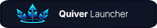

  

  <strong>A feature-rich recompilation launcher for <em>Fire Emblem: Fortune's Weave</em>, with integrated mod management and in-game enhancements.</strong> 
  Recompiled ahead of time, and played natively with no emulator. 
  Built by <a href="https://github.com/XiONDiGiTaL">XiØN</a>.

  <a href="https://xiondigital.net/EmblemWeave/">Site</a> ·
  <a href="https://github.com/XiONDiGiTaL/EmblemWeave/releases">Releases</a> ·
  <a href="docs/OVERVIEW.md">Docs</a> ·
  <a href="https://github.com/XiONDiGiTaL/EmblemWeave/wiki">Wiki</a> ·
  <a href="https://github.com/XiONDiGiTaL/EmblemWeave">GitHub</a> ·
  <a href="https://gitlab.com/XiONDiGiTaL/emblemweave">GitLab</a> ·
  <a href="https://gitgud.io/xiondigital/EmblemWeave">GitGud</a> ·
  <a href="https://emblemweave.xiondigital.workers.dev">Fallback</a>

  <a href="https://recomplauncher.com/game/emblemweave"><picture><source media="(prefers-color-scheme: dark)" srcset="https://recomplauncher.com/assets/press/launcher/badge-light.svg"></picture></a>
  

  
  
  
  
  
  
  

---

EmblemWeave is a feature-rich recompilation launcher for *Fire Emblem: Fortune's
Weave*. It builds the game ahead of time from your own dump and plays it natively
on Windows with no emulator, and it gathers everything around that into one
application: integrated mod management, save profiles and a save editor,
an in-game menu, and a recompilation pipeline you can watch run.

You supply the game from your own legally obtained copy. EmblemWeave contains no
game code, no assets and no keys, and it only ever reads your files.

> **Current release: 0.1.43.** Its [changelog](docs/changelog/0.1.43.md) fixes the launcher-started
> runtime build failing with "The input line is too long" on a long Windows environment. The
> Windows x64 package is the supported download. Linux and Steam Deck remain source-build work and
> are not advertised as downloadable releases. Field limitations from 0.1.42 for #37, #41, #75,
> #77, #78 and #79 remain documented in the changelog.

## Documentation

| | |
| --- | --- |
| 🚀 **Start here** |  |
| [Overview](docs/OVERVIEW.md) | What EmblemWeave does, the engine underneath, and the feature list. |
| [Install and play](docs/INSTALL.md) | Download, unzip, choose your dump, build once, play. |
| [Using EmblemWeave](docs/USAGE.md) | The rail of pages and the full page-by-page guide. |
| [Troubleshooting](docs/TROUBLESHOOTING.md) | When the build or the game stops, and how to report it. |
| 🛠️ **Build and run** |  |
| [System requirements](docs/REQUIREMENTS.md) | Hardware, Windows and the build tools the game needs. |
| [Building from source](docs/BUILDING.md) | The launcher, the command-line tools and the engine build. |
| [How the recompilation works](docs/ARCHITECTURE.md#how-the-recompilation-works) | The pipeline, the stages and what each piece owns. |
| 📊 **Status** |  |
| [Current status](docs/STATUS.md#current-status) | The game is playable, and this page covers what was measured and what is next. |
| [Development status](docs/DEVELOPMENT.md) | Playable-build evidence, engine integration and known limitations. |
| [Roadmap](docs/ROADMAP.md) | What is planned next, in priority order. |
| [Changelog](docs/changelog/README.md) | What changed in each release, newest first. |
| [Screenshots](docs/SCREENSHOTS.md) | The launcher's pages, from the current source tree. |
| 📚 **Reference** |  |
| [Key capabilities](docs/CAPABILITIES.md) | The deeper technical capabilities behind the feature list. |
| [Engine](docs/ENGINE.md) | The engine research log and the supporting Rust crates. |
| [Graphics](docs/GRAPHICS.md) | Upscalers, frame generation and ReShade. |
| [Performance](docs/PERFORMANCE.md) | Measured performance and the hardware matrix. |
| [Linux](docs/LINUX.md) | The Linux plan: what already works, and what is still to do. |
| [Security](docs/SECURITY.md) | What the launcher runs and reaches, and how to report a problem. |
| 📁 **Project** |  |
| [Legal](docs/LEGAL.md) | Not affiliated with Nintendo or Intelligent Systems; no game code, assets or keys. |
| [Terms](docs/TERMS.md) | Disclaimer, acceptable use and contributions. |
| [Copyright and takedown](docs/DMCA.md) | Copyright notices, the host DMCA process and the project's takedown policy. |
| [Privacy](docs/PRIVACY.md) | What stays on your PC and what the report bundle contains. |
| [Credits](#credits) | The people and projects behind EmblemWeave. |

## Project copies

The canonical repository and releases are on GitHub. The other repositories are source mirrors; the fallback is a static copy of the project site. Releases are published on GitHub.

| Where | What it is |
| --- | --- |
| [GitHub](https://github.com/XiONDiGiTaL/EmblemWeave) | Canonical source, releases and issue tracker. |
| [GitLab](https://gitlab.com/XiONDiGiTaL/emblemweave) | Source mirror. |
| [GitGud](https://gitgud.io/xiondigital/EmblemWeave) | Source mirror. |
| [Project site](https://xiondigital.net/EmblemWeave/) | Project page and release links. |
| [Fallback site](https://emblemweave.xiondigital.workers.dev) | Static copy of the project page outside GitHub. |
| [Releases](https://github.com/XiONDiGiTaL/EmblemWeave/releases) | Windows x64 downloads and release notes. |

## Disclaimer

EmblemWeave contains no game code, no game assets, no firmware and no keys, and downloads none of them. It does not provide decryption keys, circumvention instructions or links to game content. You need your own legally obtained copy of the game, and you are responsible for using it lawfully where you live. It is not affiliated with, endorsed by or supported by Nintendo or Intelligent Systems; the names identify the software it interoperates with. The launcher is GPL-3.0-only; the engine keeps its own GPL-3.0 licence and notices, and third-party components keep theirs. See [Legal](docs/LEGAL.md), [Terms](docs/TERMS.md) and [Copyright and takedown](docs/DMCA.md). This documentation is not legal advice.

## Credits

| | |
| --- | --- |
| 👑 **Creator** |  |
| [XiØN](https://github.com/XiONDiGiTaL) | Creator, Project Lead, Architecture, Design & Direction. |
| 🛠️ **Contributors** | People who have directly contributed code, fixes, features, or other development work to EmblemWeave. |
| [ranbinrang-rgb](https://github.com/ranbinrang-rgb) | Code Mods API and loader. |
| [Mi-Kel](https://github.com/Mi-Kel) | Code Mods API V4 and F1 Mods interface. |
| [moistman7](https://github.com/moistman7) | HDR, engine integration and rendering improvements. |
| [mmkzer0](https://github.com/mmkzer0) | Launcher fixes, build improvements and Vulkan integration. |
| 🤝 **Special Thanks** | Individuals whose work, preservation efforts, or continued development helped make EmblemWeave possible. |
| [Goldoire](https://github.com/Goldoire) | Original creator of fefw-recomp. |
| [Obersteinn](https://github.com/Obersteinn) | Preserved the final original fefw-recomp release and its supporting files. |
| [metrist38](https://github.com/metrist38/fefw-recomp) | A continuation of the original source with further improvements. [Trinity](https://github.com/XiONDiGiTaL/Trinity) collaborative partner. |
| [xinthefreefallxai](https://github.com/xinthefreefallxai/ObeliskChamber) | [ObeliskChamber](https://github.com/xinthefreefallxai/ObeliskChamber), based on the same origin source with further improvements. [Trinity](https://github.com/XiONDiGiTaL/Trinity) collaborative partner. |
| 🧩 **Resources & Tech** | Projects, libraries, frameworks and tools that make EmblemWeave possible. |
| [Ryujinx](https://git.ryujinx.app/ryubing/ryujinx) | Shader translation. |
| [egui](https://github.com/emilk/egui) | Launcher interface. |
| [dav1d](https://code.videolan.org/videolan/dav1d) | AV1 video decoding. |
| [libvpx](https://chromium.googlesource.com/webm/libvpx) | Video decoding support. |
| [FFmpeg](https://ffmpeg.org/) | Optional AV1 movie decoding. |
| [Unicorn](https://www.unicorn-engine.org) | Independent CPU emulation for development verification. |
| [roxmltree](https://github.com/RazrFalcon/roxmltree) | XML parsing. |
| [windows-sys](https://github.com/microsoft/windows-rs) | Windows API bindings. |
| [lz4_flex](https://github.com/PSeitz/lz4_flex) / [ruzstd](https://github.com/KillingSpark/zstd-rs) | Decompression. |
| [libm](https://github.com/rust-lang/libm) | Mathematical functions. |
| [zbic](https://github.com/kinnay/zbic) | ZBIC decoding. |
| [GameBanana](https://gamebanana.com/mods/games/26274) | Mod discovery and hosting. |

Goldoire's original fefw-recomp repository is no longer online; EmblemWeave continues from the snapshot in `engine/`. See [docs/UPSTREAM.md](docs/UPSTREAM.md).
Copyright © 2026 [XiØN](https://github.com/XiONDiGiTaL). EmblemWeave is free software under the GNU General Public License,
version 3 ([LICENSE](LICENSE)). Third-party code
keeps its own licence; [docs/THIRD_PARTY.md](docs/THIRD_PARTY.md) lists it.
