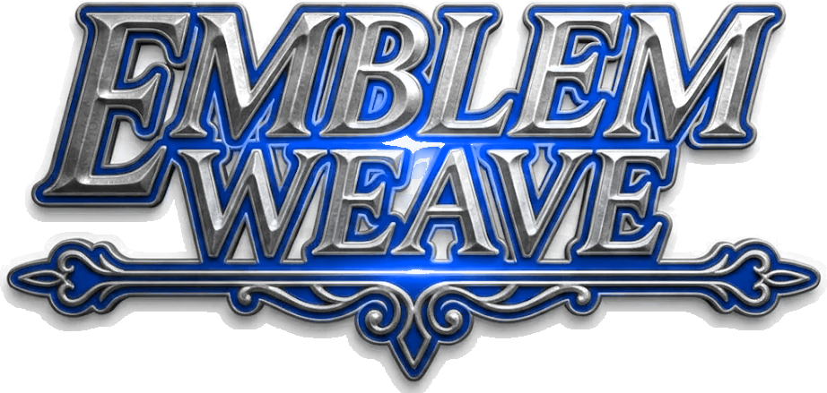
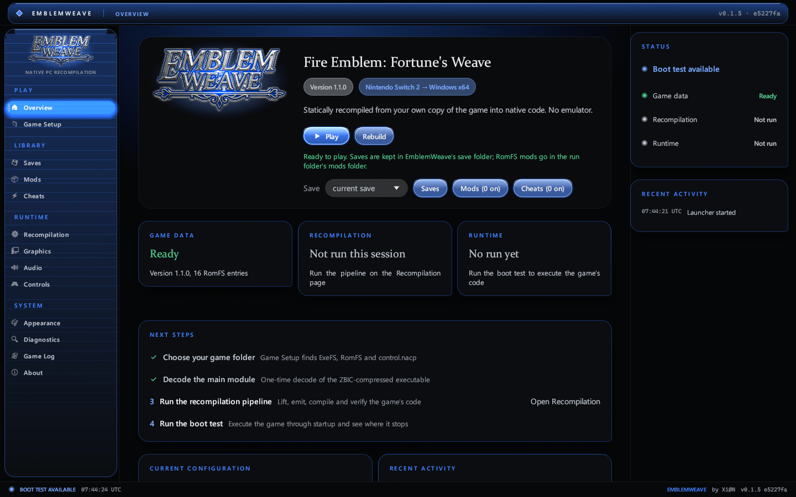
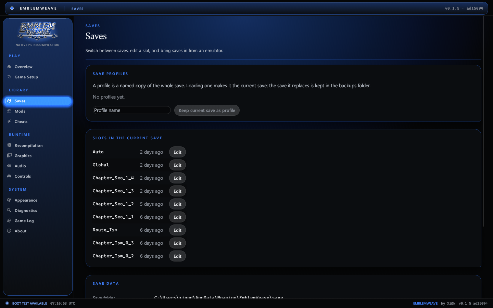
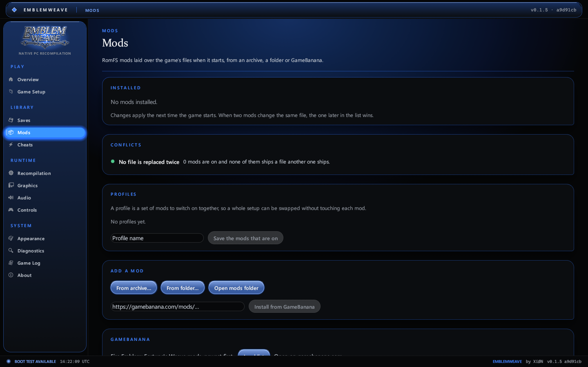
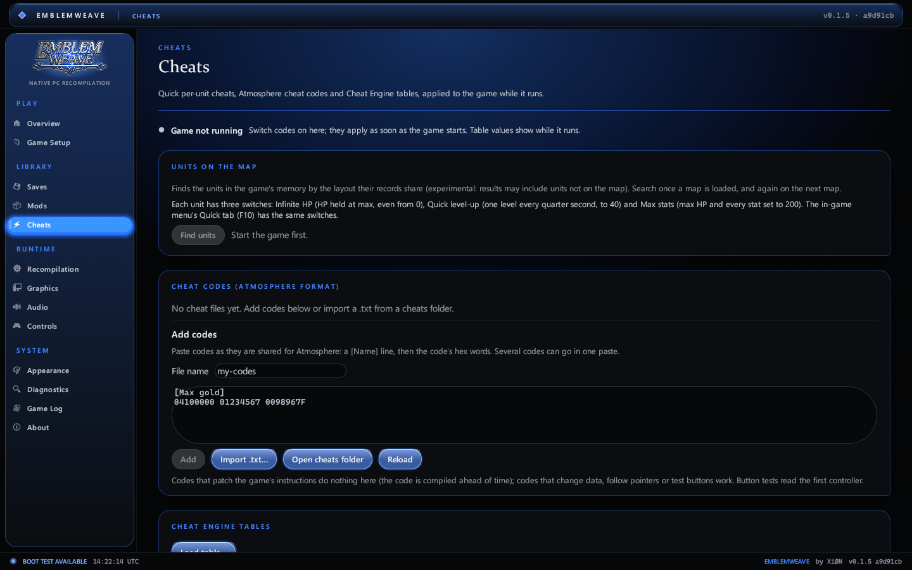
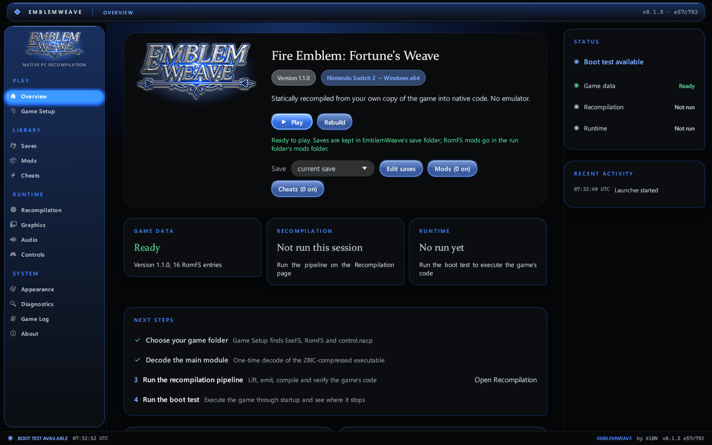
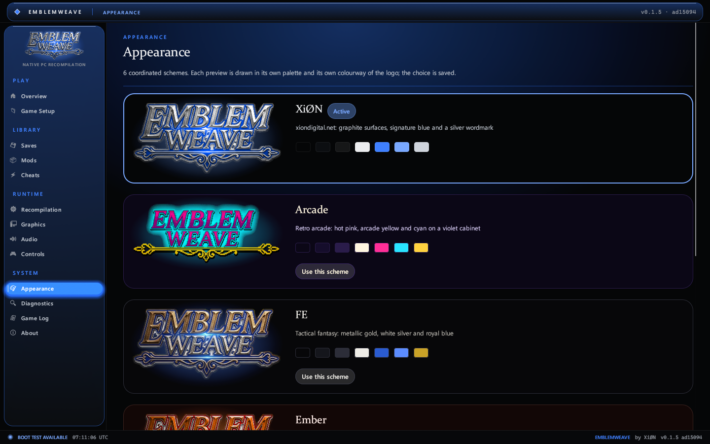
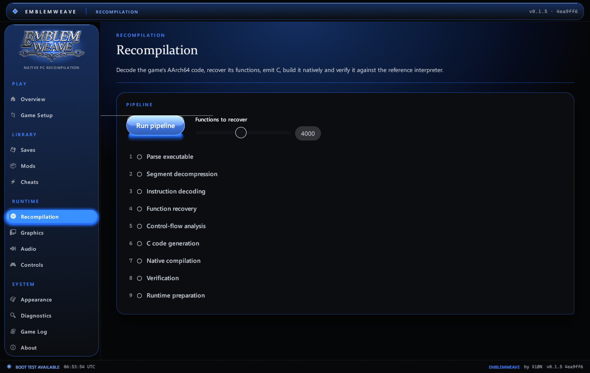
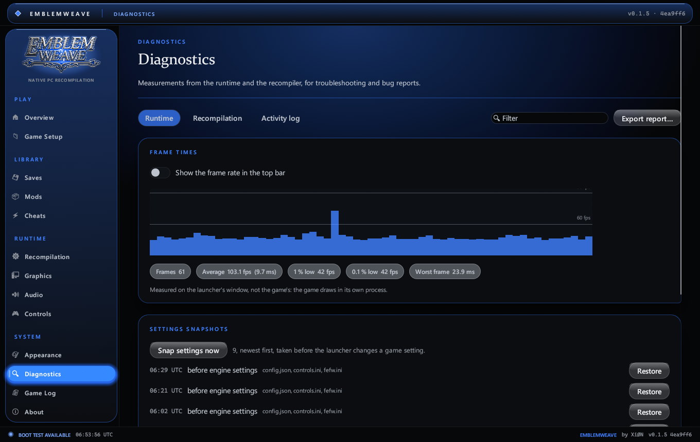

<p align="center">
  
</p>

<p align="center">
  <strong>A native Windows recompilation of <em>Fire Emblem: Fortune's Weave</em>.</strong><br>
  Built by <a href="https://github.com/XiONDiGiTaL">XiØN</a>.
</p>

<p align="center">
  
  <a href="https://github.com/XiONDiGiTaL/EmblemWeave/releases"></a>
  
  
  
  
  
</p>

---

EmblemWeave plays *Fire Emblem: Fortune's Weave* natively on Windows, from your
own copy of the game, with no emulator. The game's machine code is recompiled
ahead of time into native PC code, and the launcher brings everything around it
together: building the game from your dump, save profiles and a save editor,
mods from GameBanana, cheats, and an in-game menu.

You supply the game from your own legally obtained copy. EmblemWeave contains no
game code, no assets and no keys, and it only ever reads your files.

> **Current status: playable.** Download the [latest release](https://github.com/XiONDiGiTaL/EmblemWeave/releases/latest),
> point it at your dump, press **Build the game** once and then **Play**. On an AMD Radeon RX 7900 XT the game runs at about
> 60 fps with sound. EmblemWeave's own Rust runtime, which will take over running the game, now executes the game's code
> natively; see [Development status](#development-status) and [docs/ENGINE.md](docs/ENGINE.md).

> **AI-assisted development.** EmblemWeave is designed and directed by [XiØN](https://github.com/XiONDiGiTaL) and developed
> with the help of AI coding tools. Every change is tested against the real game and the project's own test suite before it
> is published.

<p align="center">
  
</p>

## Contents

- [What EmblemWeave does](#what-emblemweave-does)
- [Features](#features)
- [Development status](#development-status)
- [Screenshots](#screenshots)
- [Key capabilities](#key-capabilities)
- [System requirements](#system-requirements)
- [Installation](#installation)
- [Preparing your game data](#preparing-your-game-data)
- [Using the launcher](#using-the-launcher)
- [How the recompilation works](#how-the-recompilation-works)
- [Building from source](#building-from-source)
- [Testing and verification](#testing-and-verification)
- [Project structure](#project-structure)
- [Legal](#legal)
- [Credits](#credits)

## What EmblemWeave does

EmblemWeave plays *Fire Emblem: Fortune's Weave* natively on Windows, built from your own dump, with no emulator. For now the game is
built and run by a bundled third-party engine in `engine/` (GPL-3.0, with its own licence and notices in that folder), while
EmblemWeave's own runtime is completed: it translates the game's code to C++ and compiles it into `fefw.exe`, which draws with
Vulkan and plays audio through XAudio2. The EmblemWeave launcher finds and
checks your dump, builds the game with the engine, keeps your saves (including imports from Switch emulators), and starts it.

EmblemWeave also has its own recompiler and runtime in Rust, used for research and verification:

| Stage | What happens |
| --- | --- |
| **Read** | Your extracted ExeFS, RomFS and title metadata are located and validated. |
| **Decode** | The game's executable is decompressed into its code and data segments. |
| **Recompile** | Every AArch64 instruction is decoded, functions and control flow are recovered, and the code is emitted as portable C and compiled natively. |
| **Run** | The runtime maps the game, starts it the way the console's SDK does, and serves its system calls with native implementations. |

The launcher wraps all of this in one application: it shows exactly what is
ready, what is running and where the runtime stops, and it never presents a
feature as working before it is.

## Features

| | |
| --- | --- |
| **Play natively** | Build the game once from your own dump, then play it at 60 fps with sound, windowed or full screen. |
| **In-game menu** | F10 or Back + RB while playing: pause, screenshot, restart, stop and return, cheats and display settings. |
| **Saves** | Save profiles to switch between, imports from yuzu, suyu, sudachi, citron, eden and torzu, and a save editor (gold, renown, level, experience, stats, weapon masteries, items and spells). |
| **Mods** | Install RomFS mods from GameBanana (browse the game's list or paste a link), a .zip, .7z or .rar archive, or a folder, and switch each on or off. |
| **Cheats** | Quick per-unit cheats (infinite HP, quick level-up, max stats), Atmosphere cheat codes, and Cheat Engine tables with live, editable, freezable values. |
| **Launcher** | Game-data detection and validation, a live Game Log you can pop out, six colour schemes (XiØN, Arcade, FE, Ember, Verdant, Frost), diagnostics, and a recompilation pipeline you can watch run. |

## Development status

Measured on the retail game (version 1.1.0, update 131072) on 10 November 2026.

**Playable through the engine.** On an AMD Radeon RX 7900 XT the game runs at about 60 fps, with sound, from the launcher's
**Build the game** and **Play**. The first build takes a while (the game code is compiled and about 12,000 shaders are translated);
later builds only redo what changed.

EmblemWeave's own Rust runtime, which is being completed to replace the bundled engine ([docs/ENGINE.md](docs/ENGINE.md)):

| Area | Result |
| --- | --- |
| Instruction decoding | **99.97%** of 6,714,569 instruction words, including the Advanced SIMD (vector) unit, system registers and supervisor calls |
| Control-flow recovery | 304,909 basic blocks in 3,620 complete functions (4,000-function pass); 151 switch tables resolved |
| Emitted C verified | 400 recovered functions and 2,400 vector-instruction runs identical to the reference interpreter |
| Independent CPU check | Execution compared instruction by instruction against Unicorn (QEMU's AArch64 model) |
| Program modules | `main` plus the title's own `sdk`, loaded side by side; the C++ standard library and other library code run as the title's own code |
| Graphics | NVN device on the host GPU through Vulkan; queues, memory pools, buffers, textures (block-linear sizes, BC and ASTC formats), samplers, render state, shaders, swap chain, command buffers and the DLSS upscaler are served; draws are recorded and counted, not yet rendered |
| Input | Player 1 is a Pro Controller fed by the first XInput gamepad |
| Audio | The audio renderer opens and runs on its 5 ms clock; voices are not yet mixed to the speakers |
| Content | Content index, shader archives (`.bfsha`), texture archives (`.bntx`) and graphics presets load from RomFS |
| Own runtime | Runs the frame loop past the autosave notice and the opening movie into the first map load (27.9 billion instructions); draws are counted, not rendered |
| Native execution | The whole main module (807,604 functions, 10.6 million instructions) compiled ahead of time into one library; identical to the reference interpreter over the boot's first billion instructions, and about twice as fast |

The full compatibility matrix, the list of verified host services and the
known limitations live in [docs/STATUS.md](docs/STATUS.md).

## Screenshots

| | |
| --- | --- |
|  |  |
| **Overview**: Build the game and Play, save profiles, and shortcuts to the save editor, mods and cheats | **Saves**: profiles, the slots in your save and the editor, imports from emulators |
|  |  |
| **Mods**: installed mods with on/off switches, archives, folders and GameBanana | **Cheats**: Atmosphere codes and Cheat Engine tables |
|  |  |
| **Game Setup**: your dump detected and validated | **Appearance**: the XiØN, Arcade, FE, Ember, Verdant and Frost schemes |
|  |  |
| **Recompilation**: the nine-stage pipeline | **Diagnostics**: what the runtime did and where it stopped |

The screenshots are the launcher's own rendering, saved with `EmblemWeave.exe --page <page> --screenshot <file.png>`.

## Key capabilities

- **Static recompiler** for AArch64: integer, floating point, Advanced SIMD,
  atomics and exclusives, with an independent reference interpreter for every
  instruction.
- **Three layers of verification:** the emitted C against the interpreter, the
  vector unit against seeded edge cases (NaNs, infinities, signed zeros), and the
  interpreter against an independent CPU model.
- **Guest thread scheduler** with real blocking waits: mutexes, condition
  variables, events, timers, joins and sleeps, plus deadlock detection that names
  every waiting thread.
- **Native platform services:** the SDK's startup sequence, heap and frame-heap
  allocators, a read-only RomFS filesystem with a separate save directory, the
  musl C library (formatted I/O, parsing, a bit-exact math library), libc++
  runtime pieces, and system settings such as language and profile.
- **Native execution:** the recompiled code compiled ahead of time into one
  library, entered at any block, checked call by call against the interpreter
  (`EW_NATIVE_CHECK=1`).
- **A complete launcher** with game-data detection, save profiles and editing,
  mods and cheats, an in-game menu, a staged recompilation pipeline, diagnostics
  with search and export, and three themes.

## System requirements

| Component | Requirement |
| --- | --- |
| Operating system | Windows 10 or 11, 64-bit |
| Graphics | A GPU with a Vulkan 1.3 driver |
| Processor | Any x86-64 processor; recompilation benefits from more cores |
| Memory | 8 GB minimum, 16 GB recommended |
| Storage | About 30 GB for the extracted game data, plus space for build output |
| Game | Your own legally obtained copy of *Fire Emblem: Fortune's Weave* |

Building the game needs these tools (all from winget): LLVM 23 (`LLVM.LLVM`), CMake (`Kitware.CMake`), Ninja
(`Ninja-build.Ninja`), the .NET 10 SDK (`Microsoft.DotNet.SDK.10`), uv, Git and PowerShell 7, plus Visual Studio Build Tools with
"Desktop development with C++". NASM (`NASM.NASM`) is optional and speeds up movie decoding. The launcher says which are missing.

To build the launcher from source you also need the tools listed in [Building from source](#building-from-source).

## Installation

Download `EmblemWeave-<version>-windows-x64.zip` from the [releases page](https://github.com/XiONDiGiTaL/EmblemWeave/releases),
unzip it anywhere and run `EmblemWeave.exe`. Choose your game on **Game Setup**, then press **Build the game** on the
Overview page (once; it lists any build tools you still need) and **Play**. To build the launcher yourself, see
[Building from source](#building-from-source).

Settings are saved to `%APPDATA%\EmblemWeave\config.json`. Decoded modules and
build output go to `%APPDATA%\EmblemWeave\work`, and save data to
`%APPDATA%\EmblemWeave\save`. Your game folder is never written to.

## Preparing your game data

The simplest way is a **`.nup` dump** of your own copy of the game. On the
**Game Setup** page, choose **Choose .nup…** and select the file. EmblemWeave
then does the rest:

- it checks the container's table of contents and every file it reads against
  their SHA-256 hashes, so a damaged dump is reported rather than used;
- it copies the small ExeFS (about 70 MB) once into its work folder;
- it reads the RomFS (26 GB) **in place** from the `.nup`, so nothing has to be
  extracted, and it takes the title and version from the dump's own metadata.

The `.nup` is only ever read.

You can also use an extracted copy. EmblemWeave then needs:

| Item | What it is | Where it usually is |
| --- | --- | --- |
| ExeFS | The game's executable modules (`main`, `sdk`, `main.npdm`, ...) | `exefs\` |
| RomFS | The game's assets (`Fs.bin.zst` and the asset folders) | `romfs\` |
| `control.nacp` | Title metadata, including the version | `data\control\control.nacp` in an NSP extraction |

Choose the containing folder with **Folder…** on Game Setup. Plain dumps and NSP
extractions are both detected automatically, and every location can be set
individually. NSP files themselves are not read: a store NSP is encrypted, and
EmblemWeave does not handle console keys.

The game's `main` module is compressed with ZBIC, a Zstandard variant. Decode it
once with **Decode main module** on Game Setup. This currently uses a small
helper script and the Python `zbic` package:

```powershell
python -m pip install zbic
```

## Using the launcher

| Page | Purpose |
| --- | --- |
| **Overview** | **Build the game** compiles it from your dump; **Play** starts it. Load a save profile and jump to the save editor, mods and cheats. Also readiness, the boot test of the Rust runtime, and recent activity. |
| **Game Setup** | Choose and validate your game data (a `.nup` or a folder) and set the language and profile. |
| **Saves** | Save profiles: keep the current save under a name and load any profile later (the save it replaces goes to the backups folder). Lists the slots in the current save, with an editor for gold, renown and each unit's level, experience, max HP, stat gains, weapon masteries, items and spells; names come from your own game data. Imports saves from yuzu, suyu, sudachi, citron, eden and torzu, from any folder, and exports to the emulator layout. |
| **Mods** | Installed RomFS mods, switched on and off with a toggle. Installs from a .zip, .7z or .rar archive, a folder, a GameBanana link, or the game's GameBanana list browsed in the launcher. Mods that only patch the game's code (exefs) are recognised and not installed, since they cannot apply to a recompiled game. |
| **Cheats** | Atmosphere cheat codes, pasted or imported as `.txt`, each switched on and off and applied about 60 times a second while the game runs (data writes, pointer chains, conditionals, loops and controller-button tests work; instruction patches do not). Cheat Engine tables (`.CT`): `aobscan`/`aobscanregion` entries search the game's memory, and the values below them show live, can be typed in, and can be frozen. |
| **In-game menu** | While the game runs, F10 (or Back + RB on a controller) opens EmblemWeave's menu on top of it: pause and resume, a screenshot of the game window (saved to Pictures\EmblemWeave), restart at the title screen, stop and return to the launcher, quick cheats, cheat codes and tables, display settings (window mode, picture size, frame rate counter) and the controls in use. |
| **Quick cheats** | Per-unit switches for the units found in the game's memory, using the record layout of the community Cheat Engine tables (stats are single bytes, experience is a running total): infinite HP (current HP held at the unit's max HP every tick, including from 0 HP), quick level-up (the level rises one step every quarter second, up to 40) and max stats (max HP and every stat set to 200). The same switches are on the launcher's Cheats page and the in-game menu's Quick tab (F10); search again after a map loads. |
| **Recompilation** | Run the nine-stage pipeline (parse, decompress, decode, recover, analyse, emit C, compile, verify, prepare) with live progress. |
| **Graphics, Audio, Controls** | Options for EmblemWeave's own runtime, saved now and marked until its renderer, mixer and input are in place. While playing, the display settings are in the in-game menu and full rebinding is in the game engine's F1 menu. |
| **Appearance** | Choose between the [XiØN](https://github.com/XiONDiGiTaL) scheme (the xiondigital.net palette), Arcade (a retro video-game palette of hot pink, arcade yellow and cyan on violet, over a neon grid), FE (gold, white silver and royal blue), Ember (ember orange and molten gold over oxblood steel), Verdant (emerald and pale gold over moss-black) and Frost (glacier blue and ice silver over midnight). The logo artwork is recoloured to match each scheme. |
| **Diagnostics** | Stop reason, guest threads, host events, imports reached and the final events before a stop, with search and export. |
| **Game Log** | The game engine's log, followed live while the game runs: info, warnings and errors (each counted and filterable), search, copy, this run or the previous one, and **Pop out** to keep it in a window of its own. |
| **About** | Version, build revision, credits and legal information. |

Press <kbd>Ctrl</kbd> + <kbd>1</kbd> to <kbd>9</kbd> to jump between pages. From the command line,
`EmblemWeave.exe --page Diagnostics` opens a page, `--build-engine` builds the game as soon as your game data is detected,
`--boot-test` runs the boot test, `--screenshot <file.png>` saves the launcher's own frame and closes, and `--tour` walks through the features by itself (for recording showcase footage; it never saves settings).

The game runs from `%APPDATA%\EmblemWeave\play`, where the launcher writes its `fefw.ini`. RomFS mods go in that folder's `mods`
folder, one folder per mod holding `romfs/` (the layout emulators use). Every engine option is described in
`engine/fefw-recomp/runtime/docs/CONFIG.md`.

## How the recompilation works

```
  your ExeFS ──► ew-format ──► decoded segments
                                   │
                                   ▼
                              ew-lift: decode ─► recover functions ─► emit C ─► native code
                                   │                                               │
                                   ▼                                               ▼
                         reference interpreter ◄── differential verification ──► compiled C
                                   │
                                   ▼
  your RomFS ──► ew-boot: module image, SDK startup, scheduler, host services ──► the game runs
```

| Crate | Responsibility |
| --- | --- |
| `ew-format` | NSO0, ExeFS and RomFS parsing, LZ4 segments, module validation |
| `ew-lift` | AArch64 decoder, control-flow and jump-table recovery, C emitter, reference interpreter, Advanced SIMD |
| `ew-boot` | Module image and imports, SDK startup sequence, guest thread scheduler, and the host services (`nn::os`, `nn::fs`, `nn::oe`, `nn::lmem`, C and C++ runtime) |
| `ew-gfx` | The host Vulkan device behind the NVN layer |
| `ew-runtime` | Guest memory bus and service readiness |
| `apps/emblemweave` | The EmblemWeave launcher |

Design details are in [docs/ARCHITECTURE.md](docs/ARCHITECTURE.md), and the
reasoning behind static recompilation is in [docs/FEASIBILITY.md](docs/FEASIBILITY.md).

## Building from source

| Tool | Version | Used for |
| --- | --- | --- |
| [Rust](https://rustup.rs) | stable, 1.85 or newer | everything |
| Python | 3.10 or newer | the ZBIC decode helper and verification tools |
| `ziglang` (Python package) | any recent | compiling the emitted C during verification |

```powershell
git clone https://github.com/XiONDiGiTaL/EmblemWeave.git
cd EmblemWeave
cargo build --release
```

The launcher is `target\release\EmblemWeave.exe`. The command-line tools are
built alongside it:

| Tool | Purpose |
| --- | --- |
| `ew-inspect` | Inspect an ExeFS and RomFS |
| `ew-lift` | Run the recompiler and emit C, verification campaigns and reports |
| `ew-run` | Run the game in the console and print a detailed stop report (`--native` runs the compiled library) |
| `ew-native` | Lift, emit and compile the whole main module into `ew_native.dll` |

For example, to run the game from the command line:

```powershell
target\release\ew-run --module work\decoded\main --romfs D:\Games\FortunesWeave\romfs --nacp D:\Games\FortunesWeave\data\control\control.nacp
```

## Testing and verification

```powershell
cargo test --workspace
```

The repository also carries end-to-end checks that run on your own game data:

| Script | What it proves |
| --- | --- |
| `tools/verify_cfg.sh` | 400 recovered functions produce identical registers in the interpreter and in the compiled C |
| `tools/verify_simd.sh` | every distinct vector encoding behaves identically in both, across edge-case inputs |
| `tools/oracle_lockstep.py` | the interpreter agrees with an independent CPU model instruction by instruction, from a snapshot taken by `ew-run --snapshot-at` |

The verification tools need `pip install ziglang unicorn`.

## Project structure

```
apps/emblemweave/     the EmblemWeave launcher (egui)
assets/branding/     the EmblemWeave logo
crates/ew-format/    container and asset formats
crates/ew-lift/      decoder, recompiler and reference interpreter
crates/ew-boot/      runtime: image, startup, scheduler, host services
crates/ew-gfx/       host Vulkan device for the NVN layer
crates/ew-runtime/   guest memory and service registry
docs/                status, architecture, feasibility, legal
tools/               decoding helper and verification scripts
```

## Legal

EmblemWeave is an independent project by [XiØN](https://github.com/XiONDiGiTaL). It is not affiliated with,
endorsed by, or supported by Nintendo or Intelligent Systems. "Fire Emblem" and
"Fortune's Weave" are trademarks of their respective owners and are used only to
identify the software EmblemWeave works with.

The repository and its releases contain no game code, no game assets, no
firmware and no encryption keys, and EmblemWeave downloads none of them. Files
derived from your copy of the game (decoded modules and generated C) stay on
your machine and must not be redistributed. See [docs/LEGAL.md](docs/LEGAL.md).

## Credits

- **[XiØN](https://github.com/XiONDiGiTaL)**: Design
- [Goldoire](https://github.com/Goldoire/fefw-recomp): fefw-recomp as a baseline engine and all others who have contributed to that project.
- [Ryujinx](https://git.ryujinx.app/ryubing/ryujinx) (MIT): shader translation, whose shader code the build uses
- [roxmltree](https://github.com/RazrFalcon/roxmltree) (MIT / Apache-2.0) reads Cheat Engine tables; [windows-sys](https://github.com/microsoft/windows-rs) (MIT / Apache-2.0) reaches the game's memory and the controller
- [GameBanana](https://gamebanana.com/mods/games/26274) hosts the mods the Mods page lists; each mod belongs to its author
- [egui](https://github.com/emilk/egui): the launcher interface
- [libm](https://github.com/rust-lang/libm): musl's math library in Rust
- [lz4_flex](https://github.com/PSeitz/lz4_flex) and [ruzstd](https://github.com/KillingSpark/zstd-rs): decompression
- [Unicorn](https://www.unicorn-engine.org): the independent CPU model used in development
- [zbic](https://github.com/kinnay/zbic): the ZBIC decoder used by the decode helper

Follow development on [GitHub](https://github.com/XiONDiGiTaL/EmblemWeave).
Copyright © 2026 [XiØN](https://github.com/XiONDiGiTaL). EmblemWeave is free software under the GNU General Public License,
version 3 ([LICENSE](LICENSE)). Third-party code
keeps its own licence; [docs/THIRD_PARTY.md](docs/THIRD_PARTY.md) lists it.
