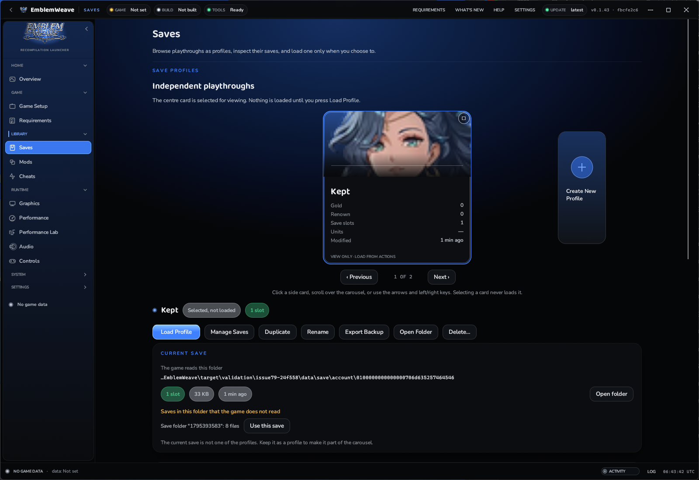
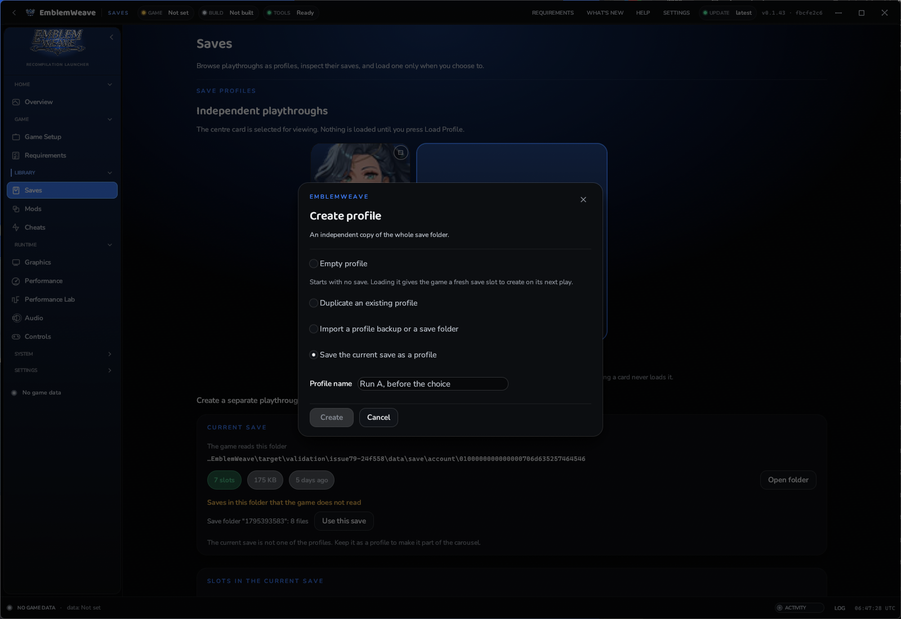

# Loading an old save in EmblemWeave 0.1.43

The launcher opens the save folder the game reads. If a playthrough was imported, copied or
restored one folder away from that path, the launcher shows **no save** and the game starts a
new profile even though the files are on disk. 0.1.43 finds those folders and installs them
with one button.

## Where the game reads saves

| Copy | Save folder |
| --- | --- |
| Installed | `%APPDATA%\EmblemWeave\save` |
| Portable | `<folder with EmblemWeave.exe>\data\save` |

The game opens only the slot files directly inside
`save\account\0100000000000000706d635257464546\000`. Profiles live in
`save\profiles\<profile name>\000`, and every replaced save is kept in `save\backups\<stamp>`.

## A folder the launcher can see but the game does not read

Examples are a folder from an old import or another launcher copy: `save\1795393583\000` with
the chapter files inside, instead of `save\account\0100…\000`.

1. Close the game.
2. Open **Saves**. Under **Current save** the folder is listed as
   `Save folder "1795393583": 8 files`.
3. Press **Use this save**.



The launcher copies the files into the account folder the game opens and moves the save that
was there into `backups\<stamp>` first. The old folder is only read; it is not moved or
deleted.

4. Start the game. **Continue** now shows the chapter, and **Current save** shows the slots
   that were imported. The old folder stays listed under the warning heading because it is
   still on disk and is only read, so check **Current save**, not the list, to confirm the copy.


## Keep it as a named profile

A profile is an independent copy you can switch to later without touching the current save.

1. **Saves → Create New Profile**.
2. Choose **Save the current save as a profile** (after the step above) or
   **Import a profile backup or a save folder** (to add a folder without changing the current
   save).
3. Type a name and press **Create**. The profile appears in the carousel; **Load Profile**
   installs it when you want it.



## A stamped slot file inside the account folder

A file named like `1795325701-Auto` or `1795325701-Chapter_…` directly in
`account\0100…\000` was moved back out of `backups\` by hand and the game cannot open it.
Press **Recover** beside it on the Saves page, or run:

```text
EmblemWeave.exe --recover-saves
```

The stamped file stays where it is; a copy is written under the name the game expects. Do not
rename it by hand.

## If you move files yourself

- Close the game first.
- Slot files go **directly** into `save\account\0100000000000000706d635257464546\000` — no
  extra folder level.
- A profile is `save\profiles\<name>\000` with the slot files inside.
- A whole old save is a folder that contains a `000` folder, placed directly under `save\`
  (for example `save\1795393583\000`). The launcher lists it as an orphan; use **Use this
  save** instead of dragging it into the account folder.
- Keep `save\backups\` until the game has loaded the save and a restart has kept it.

## If the save still does not appear

Open **Saves → Save data** and compare **Save folder** with the **Effective (fefw.ini)** line when the page shows one.
That is the path the game actually opens, and **Open folder** beside Current save opens it in
Explorer.

For a file-by-file inventory, open **Troubleshooter → Report An Issue**, put a line in the title
or description, and press **Create diagnostic ZIP**. The ZIP is saved under the launcher's
`reports` folder and contains `saves.txt`, which lists every file, size and hash under the save
root. Attach the ZIP to the issue.

See also [UPGRADE_AND_RECOVERY.md](UPGRADE_AND_RECOVERY.md#recovering-save-data-after-an-update-or-a-backup-move)
for recovery after an update.
