# Screenshots

The screenshots are the launcher's own rendering from the current source tree,
saved with `EmblemWeave.exe --page <page> --screenshot <file.png>`. The Graphics
page shows the upscaler check, FSR 3 frame generation and the ReShade status card;
the AMD preset and the display/rendering controls sit below the visible area. The
Low Memory card and the ExeFS patch support on the Mods page are also in this tree.
The screenshots were captured from this tree.

A layout check can pin the conditions a row has to survive: `--size 1280x720
--scale 2` renders at 200 % scaling, `--scroll 900` opens the page further down,
and `--gpu-list "Name|Integrated|512;Name|Discrete|20464"` supplies the adapter
list (`none` is the no-Vulkan-device case). These flags change that run only and
are never saved.

| | |
| --- | --- |
| 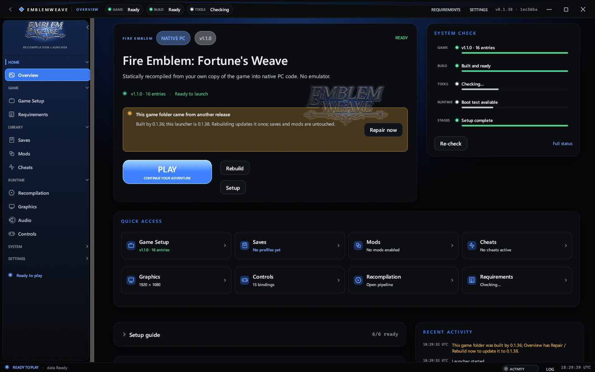 | 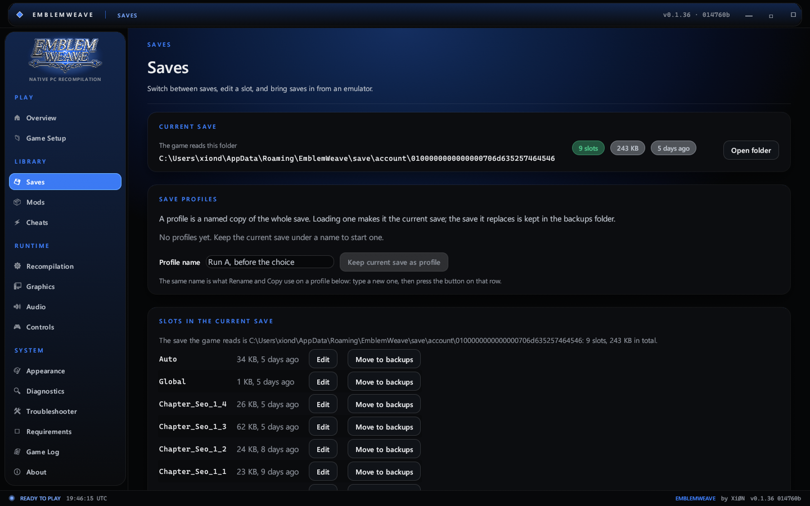 |
| **Overview**: Play and Rebuild, save profiles and shortcuts, with the status column beside it | **Saves**: profiles, the slots in your save and the editor, imports from emulators |
| 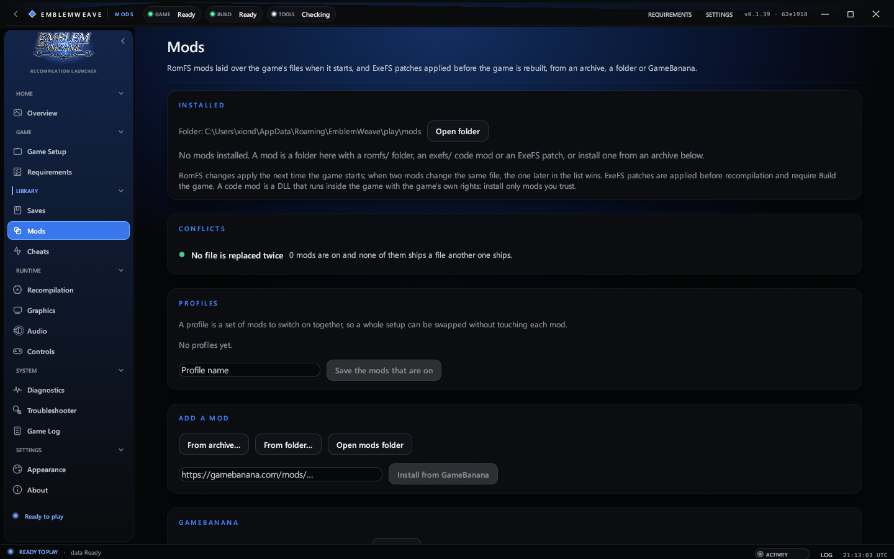 | 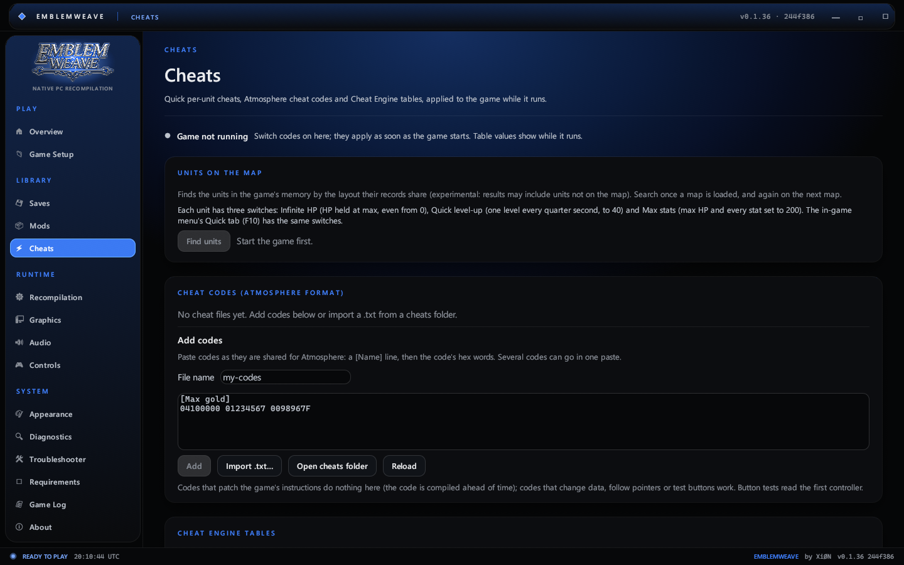 |
| **Mods**: installed mods with on/off switches, archives, folders and GameBanana | **Cheats**: Atmosphere codes and Cheat Engine tables |
| 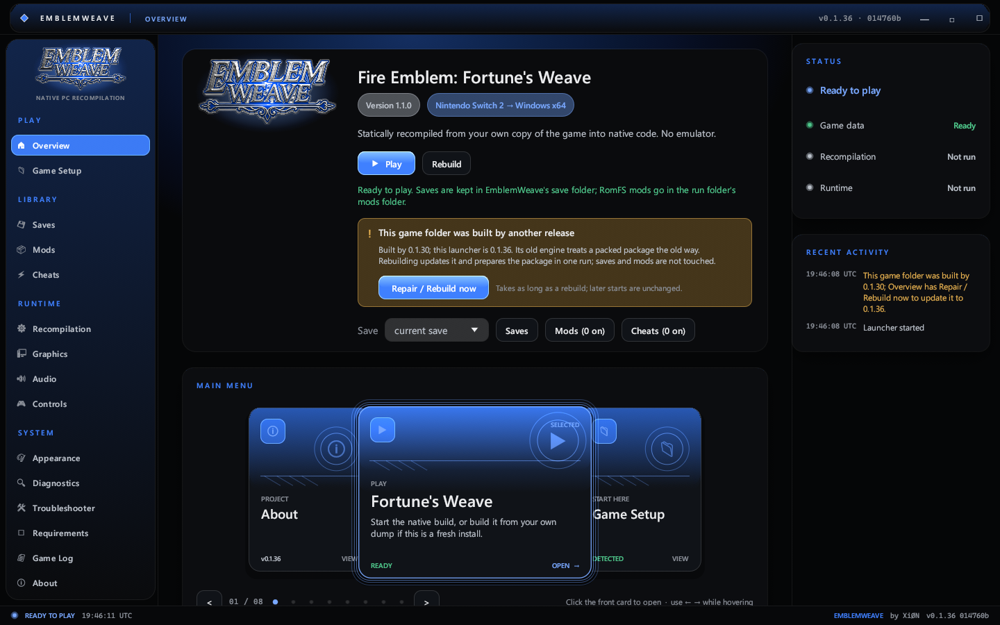 | 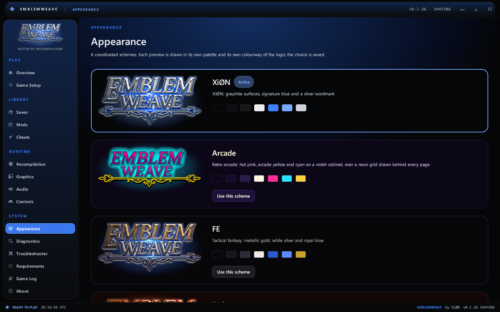 |
| **Game Setup**: your dump detected and validated | **Appearance**: the XiØN, Arcade, FE, Ember, Verdant and Frost schemes |
| 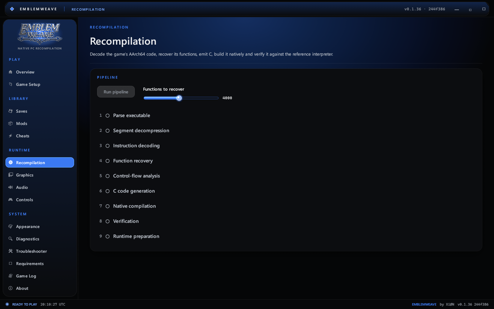 | 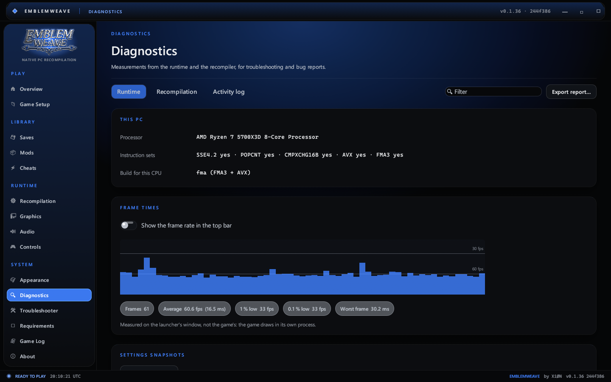 |
| **Recompilation**: the nine-stage pipeline | **Diagnostics**: what the runtime did and where it stopped |
| 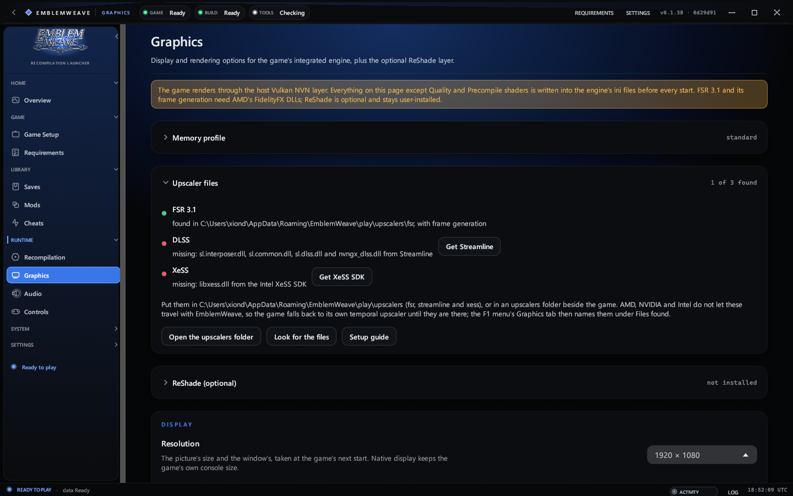 | 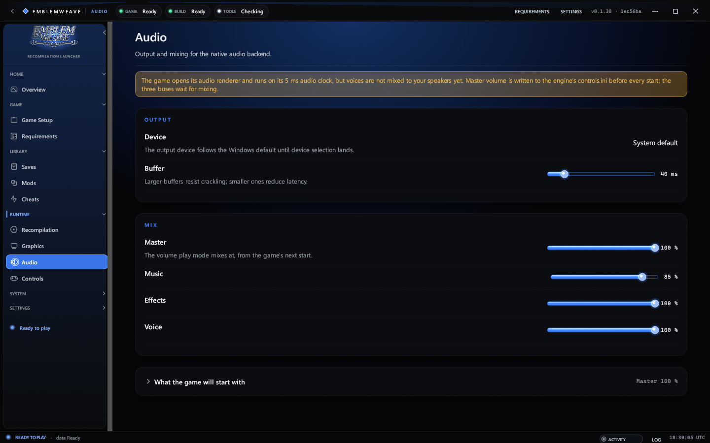 |
| **Graphics**: display, upscalers, FSR 3 frame generation and optional ReShade | **Audio**: output, mix and what the game will start with |
| 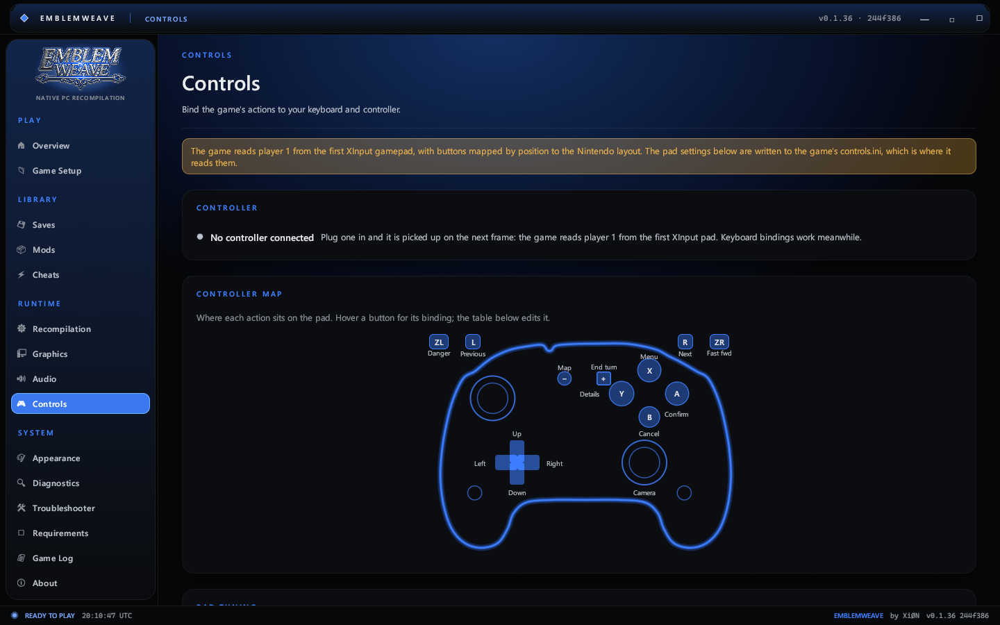 | |
| **Controls**: the pad map, bindings, trigger travel and tuning | |
